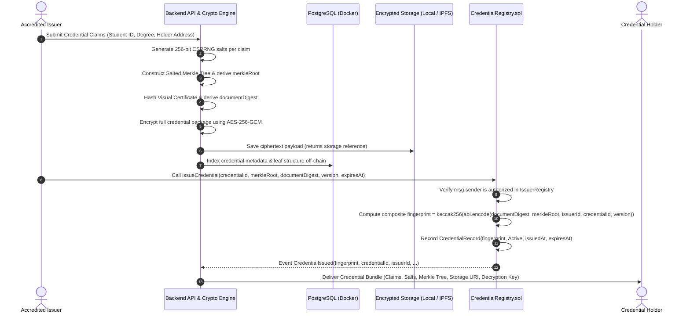

# Architecture Overview: Blockchain-Based Credential Lifecycle Verification System

---

## 1. Introduction & Design Objective

The **Blockchain-Based Credential Lifecycle Verification System** is an industry-oriented, privacy-preserving credential issuance, lifecycle management, and verification framework designed for academic, corporate, and professional qualifications.

### Primary Architectural Invariant
> **Strict Zero-PII On-Chain**: Complete digital certificates, personal identifiable information (PII), student names, grades, and unencrypted document payloads are **never** stored on the blockchain. The distributed ledger functions solely as an immutable, tamper-proof state machine, timestamp anchor, and access-controlled registry for 32-byte cryptographic fingerprints.

---

## 2. Core Methodological Pillars

```
+----------------------------------------------------------------------------------------------------+
|                                         Core Methodology                                           |
+------------------------------+------------------------------------+--------------------------------+
|  1. Cryptographic Hashes     |  2. Authenticated Issuer Registry  |  3. Lifecycle State Management |
|  - Salted Merkle Leaves      |  - On-Chain Accreditation          |  - Active, Suspended, Revoked, |
|  - Distinct Composite Hash   |  - Role-Based Issuance Control     |    Superseded, Archived        |
|    (document, root, IDs)     |  - 2-Step Key Rotation             |  - Dynamic Expiration Lookup   |
+------------------------------+------------------------------------+--------------------------------+
|  4. Protected Off-Chain      |  5. Verifier Challenge-Response    |  6. Privacy & Selective        |
|     Storage                  |     Handshake                      |     Disclosure                 |
|  - Local/IPFS AES-256-GCM    |  - EIP-712 Nonce Verification      |  - Salted Attribute Blinding   |
|  - Modular Storage Adapter   |  - Holder Cryptographic Proof      |  - Computational Hiding        |
+------------------------------+------------------------------------+--------------------------------+
```

### 2.1 Cryptographic Primitives: Leaves, Merkle Root, and Composite Fingerprint

To support selective disclosure without conflating documents, attribute claims, and identity, the architecture establishes three distinct cryptographic layers:

1. **Deterministic Canonicalization**: The credential claims payload is canonicalized using RFC 8785 (JSON Canonicalization Scheme - JCS) to ensure deterministic attribute ordering and UTF-8 encoding across languages.
2. **Domain-Separated Salted Leaf Hashing**: Each claim is paired with a 256-bit cryptographically secure random salt ($s_i$). Leaves use typed 32-byte padded encoding with a `0x00` leaf domain separator:
   $$\text{leaf}_i = \text{keccak256}\Big(\text{abi.encode}(\text{bytes1}(0x00), \text{bytes32 } s_i, \text{string } \text{key}_i, \text{string } \text{value}_i)\Big)$$
3. **Sorted-Pair Merkle Tree Construction**: Internal nodes use commutative sorted-pair hashing with a `0x01` internal node domain separator:
   $$\text{parent} = \text{keccak256}\Big(\text{abi.encode}(\text{bytes1}(0x01), \min(\text{bytes32 left}, \text{bytes32 right}), \max(\text{bytes32 left}, \text{bytes32 right}))\Big)$$
   *Odd-leaf rule*: If a level contains an odd number of nodes, the unpaired node is promoted directly to the parent level without duplication, eliminating duplicate-leaf malleability.
   The resulting root is the **`merkleRoot` (`bytes32`)**.

   > **Authoritative Specification & OpenZeppelin Note**: While this design adopts commutative sorted-pair ordering, the addition of the `0x01` domain separator prefix and typed 32-byte padded `abi.encode` makes this a **custom construction that is NOT byte-for-byte compatible with OpenZeppelin's standard `MerkleProof.sol`** (which hashes un-prefixed packed pairs via `bytes.concat(min, max)`). All verification routines across Python, TypeScript, and Solidity must use this exact domain-separated construction.

4. **Document Digest**: The visual certificate or canonical full document is independently hashed (Keccak-256 or SHA-256) into a 32-byte **`documentDigest` (`bytes32`)**.
5. **Metadata Digest**: The canonical RFC 8785 metadata payload is hashed into a 32-byte **`metadataDigest` (`bytes32`)**.
6. **Composite Credential Fingerprint**: The on-chain anchor binds all six inputs into a single composite fingerprint:
   $$\text{fingerprint} = \text{keccak256}\Big(\text{abi.encode}(\text{documentDigest}, \text{metadataDigest}, \text{merkleRoot}, \text{issuerId}, \text{credentialId}, \text{version})\Big)$$

*Invariant*: The `merkleRoot` (which enables attribute selective disclosure), `metadataDigest` (canonical metadata payload digest), and `fingerprint` (which anchors the entire credential bundle on-chain) are strictly distinct cryptographic identifiers.

### 2.2 Authenticated Issuer Registry
To prevent unauthorized parties from issuing counterfeit credentials:
- An on-chain `IssuerRegistry` contract maintains verified public addresses and metadata of accredited institutions.
- The `CredentialRegistry` contract enforces that only addresses currently flagged as active and authorized in `IssuerRegistry` can anchor new credential fingerprints or mutate their lifecycle states.

### 2.3 Credential Lifecycle State Machine
Credentials undergo distinct lifecycle phases over time:
- **`None`** (0): Credential fingerprint does not exist in the registry.
- **`Active`** (1): Credential has been issued and is currently in good standing.
- **`Suspended`** (2): Credential is temporarily paused (e.g., pending administrative audit or disciplinary review).
- **`Revoked`** (3): Credential has been permanently invalidated (e.g., academic fraud, administrative cancellation). Terminal state.
- **`Superseded`** (4): Replaced by a newer version. Points to the replacement credential's fingerprint.
- **`Archived`** (5): Administratively retired upon program completion without negative sanction.

#### How Expiration is Represented (EVM Storage & Gas Optimization)
In smart contract design, storing an explicit mutable `Expired` state in contract storage is an anti-pattern because transitioning past-due credentials would require periodic gas-consuming transactions (or automated external keepers).

Instead:
- The contract stores `uint64 expiresAt` (Unix timestamp; `0` denotes non-expiring).
- The persistent storage enum is:
  ```solidity
  enum StoredStatus { None, Active, Suspended, Revoked, Superseded, Archived }
  ```
- **Dynamic Resolution**: A contract view function and backend verification clients compute the effective logical state dynamically:
  $$\text{EffectiveStatus} = \begin{cases} 
  \text{None} & \text{if status} == \text{None} \\
  \text{Revoked} & \text{if status} == \text{Revoked} \\
  \text{Suspended} & \text{if status} == \text{Suspended} \\
  \text{Superseded} & \text{if status} == \text{Superseded} \\
  \text{Archived} & \text{if status} == \text{Archived} \\
  \text{Expired} & \text{if status} == \text{Active} \land \text{expiresAt} > 0 \land \text{block.timestamp} \ge \text{expiresAt} \\
  \text{Active} & \text{otherwise}
  \end{cases}$$

### 2.4 Protected Off-Chain Certificate Storage
- Complete certificate documents and full attribute catalogs are stored off-chain using AES-256-GCM authenticated encryption.
- The architecture uses a **Modular Storage Adapter**:
  - **Local Development**: Encrypted filesystem storage (`storage/encrypted/`) with AES-256-GCM envelope encryption.
  - **Production/Extension**: Pluggable IPFS (Pinata/Kubo) adapter implementing the same abstract interface.
- Holders receive the ciphertext reference and the decryption key, maintaining complete data sovereignty.

### 2.5 Verifier-Specific Nonce / Challenge-Response Handshake
Presenting static signed credentials exposes holders to **presentation interception and replay attacks** (a malicious verifier or interceptor re-submitting Alice's presentation as their own).

The system mitigates this via an interactive challenge-response protocol:
1. Verifier generates an ephemeral `nonce` ($N \in \{0,1\}^{256}$), binds it to a `verifier_id` and session expiration timestamp ($T_{\text{exp}}$).
2. The holder signs an **EIP-712 structured data payload** containing $(R_{\text{merkle}}, N, \text{verifier\_id}, T_{\text{exp}})$ using their private key.
3. The verifier validates the signature against the holder address bound within the credential's Merkle tree, confirming both proof freshness and authentic holder custody.

### 2.6 Privacy Analysis & Realistic Security Guarantees of Salting

#### Attack Surface: Low-Entropy Attribute Guessing
When credential attributes have low entropy (e.g., GPA with ~200 possible values, graduation year with ~10 values, letter grades), unsalted hashes allow an adversary to precompute candidate hashes (dictionary/rainbow-table attack) and match them against sibling hashes exposed in Merkle proofs.

#### Actual Protection and Assumptions
1. **Computational Hiding (Not Information-Theoretic)**: Salting provides *computational security against offline brute-force attacks* under the standard cryptographic assumption that Keccak-256 is collision- and preimage-resistant, and that each salt $s_i$ is drawn uniformly at random from a 256-bit space ($s_i \xleftarrow{\$} \{0,1\}^{256}$) via a cryptographically secure pseudo-random number generator (CSPRNG).
2. **Entropy Lower Bound**: An attacker attempting to brute-force a low-entropy attribute must search a space of $|V| \times 2^{256}$, where $|V|$ is the attribute domain size. This requires $2^{256}$ hash evaluations, rendering dictionary attacks computationally infeasible.
3. **Known Boundaries & Residual Leakage**:
   - Salting does **not** conceal the total number of leaves (attributes) in the Merkle tree or the tree depth.
   - Salting does **not** protect against side channels if salts are compromised or reused across credentials.
   - Each claim must receive an independent, unique salt. Salts must never be reused across credentials or claims.

---

## 3. Cryptographic Synergy & Key Ownership

The system coordinates distinct cryptographic primitives to ensure trust and privacy:

```
[ Claim 1 + Salt 1 ] ----> Leaf 1 \
[ Claim 2 + Salt 2 ] ----> Leaf 2 --+---> Sorted-Pair Merkle Root (merkleRoot)
[ Holder Public Key + S3 ] -> Leaf 3 /        |
                                              |
      [ documentDigest + merkleRoot + issuerId + credentialId + version ]
                                              |
                                              v
                              keccak256(abi.encode(...))
                                              |
                                              v
                              Composite Fingerprint (fingerprint)
                                              |
                                              v
                              [ Anchor on-chain in CredentialRegistry.sol ]
```

```
[ Selective Disclosure Flow ]
1. Holder discloses Claim 1, Salt 1, and sibling proofs for Leaf 2 and Leaf 3.
2. Verifier recomputes Leaf 1 = keccak256(abi.encode(0x00, Salt 1, "degree", "B.S. CS")).
3. Verifier traverses sorted-pair tree to reconstruct candidate merkleRoot'.
4. Verifier receives Verifier Challenge: Ephemeral Nonce N + VerifierID + Expiry.
5. Holder signs EIP-712 challenge containing (merkleRoot', N, VerifierID, Expiry) with Holder Key.
6. Verifier verifies:
   a) Holder signature recovers to Holder Public Key (disclosed in Leaf 3).
   b) Verifier calls CredentialRegistry.verifyCredential(fingerprint, merkleRoot', documentDigest).
   c) Contract asserts fingerprint record matches, storedStatus == Active, not expired, and issuer is active.
```

### Key Ownership Architecture

| Key Type | Key Generation | Storage & Protection | Usage in System |
| :--- | :--- | :--- | :--- |
| **Issuer Authority Key** | `secp256k1` EVM keypair / BIP-39 mnemonic. | **Local Dev**: Kept in `.env` (strictly excluded by `.gitignore`) or encrypted keystore JSON.<br>**Production**: Hardware Security Module (HSM), Cloud KMS, or Gnosis Safe Multi-Sig. | Signs transactions to anchor fingerprints in `CredentialRegistry.sol` and manage lifecycle status (`suspend`, `revoke`). |
| **Holder Identity Key** | `secp256k1` keypair (MetaMask / Web3 wallet or Web Crypto API). | **Client-Side**: Maintained in user's browser wallet (MetaMask) or browser encrypted vault (IndexedDB with AES-GCM password). **Never transmitted to backend or verifiers.** | Signs EIP-712 challenge nonces to prove ownership of the credential and prevent presentation replay. |
| **Document Encryption Key** | 256-bit AES symmetric key (`crypto.getRandomValues`). | Held by Holder; delivered in credential package. Stored in client vault. | Encrypts/decrypts the complete off-chain certificate document stored in local storage or IPFS. |

---

## 4. Verification Rules & Evaluation Checklist

Verifiers execute a strict, deterministic 7-step verification procedure:

```
+------------------------------------------------------------------------------------+
|                         Verifier Execution Checklist                               |
+----+-----------------------------+-------------------------------------------------+
| Step| Verification Action          | Failure Condition                               |
+----+-----------------------------+-------------------------------------------------+
| 1  | Nonce Freshness Check       | Nonce is expired (T > T_exp) or not in session  |
| 2  | EIP-712 Signature Recovery  | Invalid signature format or recovery failure    |
| 3  | Holder Address Match        | Recovered signer != disclosed Holder Address    |
| 4  | Leaf Hash Reconstruction    | Recomputed leaf != expected hash format         |
| 5  | Merkle Root Recomputation   | Sibling path traversal fails to reproduce root  |
| 6  | On-Chain Status Lookup      | Status != Active OR (expiresAt > 0 & expired)   |
| 7  | Issuer Accreditation Check  | Issuer is not active in IssuerRegistry.sol      |
+----+-----------------------------+-------------------------------------------------+
```

---

## 5. Minimal Local-Development Architecture

The project utilizes a self-contained, reproducible, industry-standard development environment leveraging **Docker Compose for PostgreSQL** alongside local developer runtimes:

```
+-----------------------------------------------------------------------------------------------------+
|                                   Minimal Local Development Stack                                   |
+--------------------------+---------------------------------+----------------------------------------+
|  Subsystem               |  Technology Selection           |  Local Development Role                |
+--------------------------+---------------------------------+----------------------------------------+
|  Database                |  PostgreSQL 16 (Docker Compose) |  Containerized relational DB on :5432  |
|                          |  + SQLAlchemy + Alembic         |  Off-chain metadata, nonces, indexer   |
+--------------------------+---------------------------------+----------------------------------------+
|  Blockchain Node         |  Hardhat Local Network          |  Zero-gas EVM node on :8545            |
|                          |  (npx hardhat node)             |  Pre-funded issuer & holder accounts   |
+--------------------------+---------------------------------+----------------------------------------+
|  Smart Contracts         |  Solidity 0.8.24 + Hardhat      |  Contract compilation, OpenZeppelin,   |
|                          |                                 |  Mocha/Chai contract unit tests        |
+--------------------------+---------------------------------+----------------------------------------+
|  Backend API             |  FastAPI (Python 3.10+)         |  REST endpoints on :8000, Web3.py,     |
|                          |  + Uvicorn + Pydantic v2        |  Merkle tree builder, crypto engine   |
+--------------------------+---------------------------------+----------------------------------------+
|  Off-Chain Storage       |  Local AES-256-GCM Filesystem   |  storage/encrypted/ adapter            |
|                          |  (Modular StorageAdapter)       |  Simulates IPFS without paid API keys  |
+--------------------------+---------------------------------+----------------------------------------+
|  Frontend Portal         |  Vite + React (TypeScript)      |  Modern SPA on :5173, MetaMask / Ethers|
|                          |  + TailwindCSS / Vanilla CSS    |  Issuer, Holder, and Verifier portals  |
+--------------------------+---------------------------------+----------------------------------------+
```

---

## 6. End-to-End Operational Workflows

### 6.1 Credential Issuance Flow



### 6.2 Verification with Selective Disclosure & EIP-712 Challenge-Response

```mermaid
sequenceDiagram
    autonumber
    actor Verifier as Verifier (Employer)
    actor Holder as Credential Holder
    participant Backend as Verification Service
    participant Chain as CredentialRegistry.sol

    Verifier->>Backend: Request Challenge (Session ID, Expiration = 5 min)
    Backend-->>Verifier: Return Challenge Nonce N (32 bytes)
    Verifier->>Holder: Send Verification Request (Required Claims: [Degree], Nonce N, VerifierID)
    Holder->>Holder: Extract Disclosed Claims + Salts for [Degree]
    Holder->>Holder: Assemble Merkle sibling path for undisclosed leaves
    Holder->>Holder: Sign EIP-712 Challenge (merkleRoot, Nonce N, VerifierID, Expiry) with Holder Key
    Holder->>Verifier: Transmit Presentation (Disclosed Claims, Salts, Merkle Proof, EIP-712 Signature, fingerprint, documentDigest)
    Verifier->>Backend: Submit Presentation for Verification
    Backend->>Backend: 1. Confirm Nonce N is fresh and unexpired
    Backend->>Backend: 2. Recompute Leaf hashes using Disclosed Claims and Salts
    Backend->>Backend: 3. Traverse sorted-pair Merkle path to derive candidate merkleRoot'
    Backend->>Backend: 4. Recover signer from EIP-712 signature; verify matches Holder Address claim
    Backend->>Chain: 5. Call verifyCredential(fingerprint, merkleRoot', documentDigest)
    Chain-->>Backend: Return VerificationResult { isValid: true, code: Valid, storedStatus: Active, issuerId, isIssuerActive: true, expiresAt }
    Backend-->>Verifier: Result: Cryptographically Valid, Untampered, and Active
```

---

## 7. Security & Threat Mitigation Matrix

| Threat Vector | Attack Scenario | Architectural Mitigation |
| :--- | :--- | :--- |
| **Credential Forgery** | Attacker creates fake degree from legitimate university. | Smart contract allows only accredited addresses in `IssuerRegistry` to register credentials. |
| **On-Chain Privacy Leak** | PII permanently exposed on public blockchain ledger. | **Strict Zero-PII Invariant**: Only 32-byte hashes/roots are committed to the chain. |
| **Attribute Dictionary Attack** | Verifier guesses undisclosed low-entropy attributes from Merkle proofs. | **Salted Leaf Design**: Each leaf uses a random 256-bit salt ($2^{256}$ search space), making offline brute-force computationally infeasible. |
| **Hash Collision Vulnerability** | Dynamic string packing collision in `encodePacked`. | **Padded Encoding**: Using standard `abi.encode` with 32-byte boundaries and length fields. |
| **Second-Preimage Attack** | Crafting an internal Merkle node that collides with a leaf. | **Domain Separation**: `0x00` prefix for leaves, `0x01` prefix for internal nodes. |
| **Duplicate-Leaf Malleability** | Duplicating the last leaf in an odd-sized tree (CVE-2012-2459). | **Odd-Leaf Promotion**: Unpaired leaves are promoted directly to the next level without duplication. |
| **Presentation Replay** | Attacker intercepts Alice's proof and presents it to another employer. | **EIP-712 Challenge-Response**: Presentations are bound to an ephemeral, verifier-specific nonce signed by the holder's private key. |
| **Post-Issuance Tampering** | Altering grades or names on an issued document. | Any modification to claims or salts alters the leaf hash and breaks Merkle root consensus with the on-chain anchor. |
| **Revocation Lag** | Use of a revoked license before notification reaches verifier. | Instant, direct on-chain state query to `CredentialRegistry`. |
| **Credential Expiration Bypass** | Presenting an expired certification as currently valid. | Contract and verifier dynamically compare `expiresAt` against block timestamp; expires deterministically without keeper transactions. |

---

## 8. Catalog of Architectural Decisions & Invariants

1. **Database Persistence**: **PostgreSQL 16** containerized via Docker Compose is the project's standardized database for off-chain metadata, indexing, and nonces.
2. **Merkle Proof Standardization**: Commutative sorted-pair Merkle tree (`keccak256(abi.encode(bytes1(0x01), min(a,b), max(a,b)))`) with domain separation selected over directional trees to minimize proof size and simplify validation.
3. **Challenge Signature Standard**: **EIP-712** selected over raw string signing (`personal_sign`) to provide structured, typed presentation authorization and prevent cross-domain phishing.
4. **Decentralized Storage Pluggability**: Local AES-256-GCM filesystem adapter implemented with an abstract interface (`StorageAdapter`), allowing transparent drop-in upgrade to IPFS (Pinata/Kubo) without backend refactoring.
