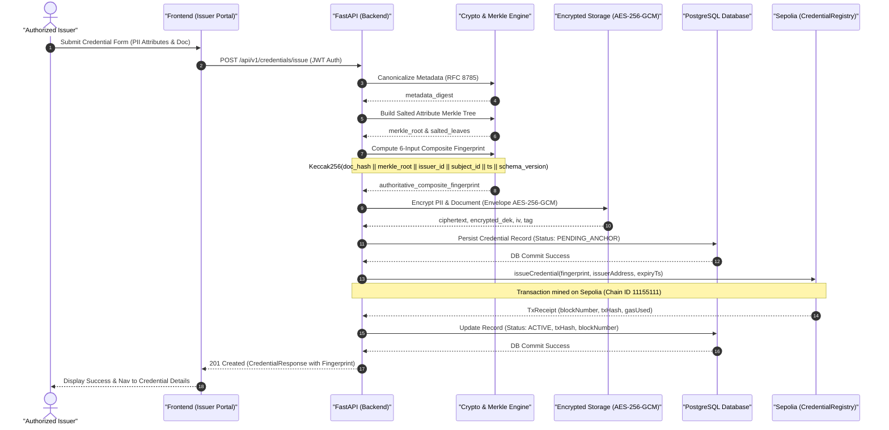
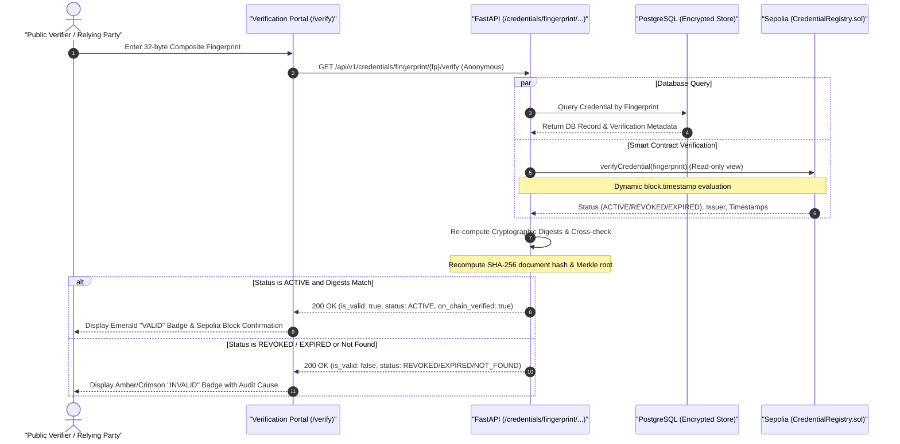
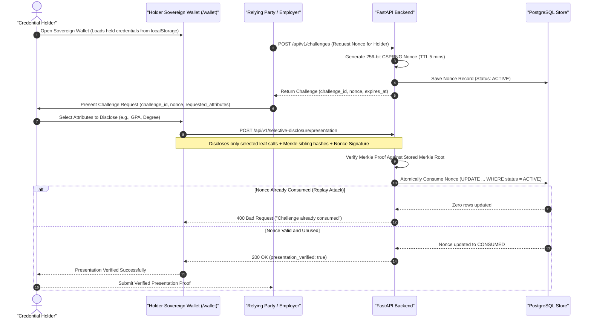
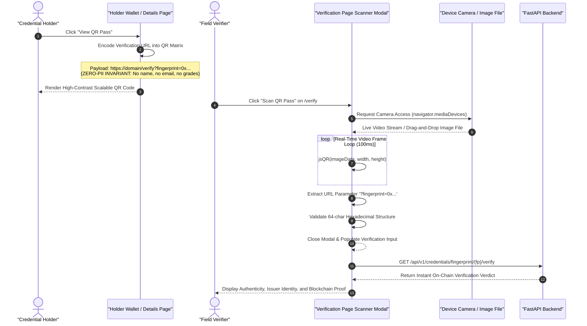

# System Architecture and Sequence Diagrams

**Project**: Blockchain-Based Credential Lifecycle Verification System  
**Document**: Architectural Sequence Diagrams  
**Date**: October 25, 2026  
**Status**: Verified & Implemented  

---

## 1. Overview

This document provides formal sequence diagrams detailing the four core workflows of the Blockchain-Based Credential Lifecycle Verification System:
1. **Credential Issuance and On-Chain Anchoring**
2. **Zero-Trust Public Verification**
3. **Holder Sovereign Wallet and Anti-Replay Challenge-Response**
4. **Zero-PII QR Code Generation and Physical/Camera Scanning**

All diagrams reflect the actual implemented software components in the FastAPI backend, React frontend, PostgreSQL database, and Sepolia Ethereum smart contracts.

---

## 2. Sequence Diagram 1: Credential Issuance and Sepolia Anchoring

This workflow details how an institutional issuer generates, cryptographically binds, encrypts, and on-chain anchors a verifiable credential while maintaining the strict zero-PII on-chain invariant.

---

## 3. Sequence Diagram 2: Zero-Trust Public Verification

This workflow details how any anonymous public verifier or relying party validates a credential's authenticity without authentication, institutional credentials, or access to sensitive holder PII.

---

## 4. Sequence Diagram 3: Holder Sovereign Wallet & Anti-Replay Challenge-Response

This workflow details how a credential subject (holder) manages credentials locally, selects specific attributes to disclose, and signs a single-use replay-protected challenge requested by a verifier.

---

## 5. Sequence Diagram 4: Zero-PII QR Pass Generation and Camera Scanning

This workflow details how the holder renders an ephemeral, zero-PII QR pass, and how a field verifier scans the QR code via hardware camera or file upload to trigger instant cryptographic verification.

