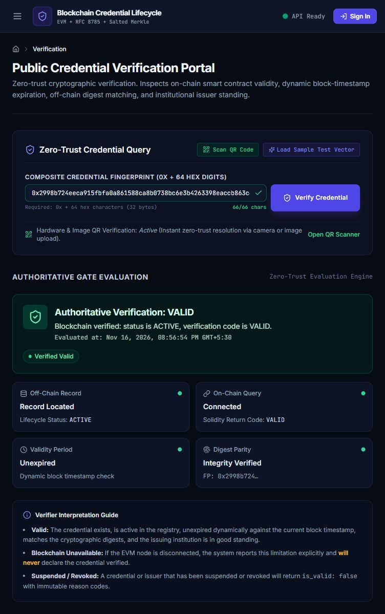

# Credential lifecycle demonstration - results and issue report

**Executed:** 16 November 2026, approximately 20:52-20:57 IST (Asia/Kolkata).

**Result:** PASS for the exercised local workflows. 39 HTTP status assertions passed, 227 automated tests passed, and the frontend production build succeeded. A fresh browser-issued credential was left ACTIVE and verified as VALID.

## 1. What was actually run

Two complementary runs were performed:

1. **API plus real blockchain run:** `scripts/verify_local_e2e.py` exercised the running FastAPI service and deployed Hardhat contracts. This was not a mock blockchain run. It covered issuer inspection, document storage, issuance, disclosure, replay rejection, lifecycle transitions, version history, and negative authorization checks.
2. **Browser run:** the complete five-step issuance wizard was used, followed by encrypted package export, sign-out, Holder sign-in, file import, live wallet verification, QR rendering, and opening the QR pass's public verification link. The new public-verification tab was unauthenticated and showed VALID.

Selective disclosure and lifecycle mutations were exercised through HTTP in this run; their complete multi-role file-exchange UI sequence was not replayed manually. Frontend regression tests cover selective-disclosure interactions. No phone-camera QR scan was performed.

The existing healthy local session was reused so the user's other demonstration records were not erased. This run checked startup readiness; it did not restart or redeploy the stack.

## 2. Environment

| Component | Observed configuration |
|---|---|
| Frontend | http://127.0.0.1:5173 |
| Backend | http://127.0.0.1:8000 |
| Blockchain RPC | http://127.0.0.1:8545 |
| Network | Local Hardhat, chain ID 31337 |
| Database | SQLite in the isolated local session |
| Health | API ready; database and blockchain connected |
| Contracts | Both configured contracts had bytecode and were loaded |
| Institution | Local Demo University, active in database and on-chain |

Authorized issuer ID:

```text
0x0000000000000000000000000000000000000000000000000000000000000001
```

Local signer address (public address, not a private key):

```text
0xf39Fd6e51aad88F6F4ce6aB8827279cffFb92266
```

No public-network transactions or real student information were used. Authentication tokens and private signing/encryption keys are not included in the evidence files.

## 3. End-to-end results

| Stage | Action and observed outcome | Result |
|---|---|---|
| Readiness | Checked database, RPC, chain ID, deployed contracts and signer availability | PASS |
| Issuer | Read seeded issuer profile and status; database ACTIVE and on-chain active | PASS |
| Upload | Uploaded a real, viewable PNG demonstration certificate | PASS |
| Storage inspection | Retrieved stored metadata; document digest matched upload result | PASS |
| Metadata | Canonicalized metadata and calculated its digest | PASS |
| Merkle tree | Generated salted claim tree and preserved original salts | PASS |
| Issuance | Issued version 1; returned CONFIRMED and ACTIVE | PASS |
| Idempotency | Repeated the same issuance request; transaction hash remained the same | PASS |
| Role boundary | Holder attempted credential-list access; HTTP 403 as expected | PASS |
| Public verification | Active credential verified valid | PASS |
| Selective disclosure | Generated and verified a presentation disclosing only degree | PASS |
| Replay | Submitted the same verified presentation again; HTTP 409 as expected | PASS |
| Suspension | Credential became SUSPENDED; public and presentation verification were invalid | PASS |
| Reactivation | Suspended credential returned to ACTIVE and verified valid | PASS |
| Version replacement | Issued version 2; old fingerprint became invalid and version 2 presentation verified | PASS |
| Revocation | Version 2 became REVOKED and no longer verified valid | PASS |
| Terminal status | Attempt to reactivate revoked credential returned HTTP 400 | PASS |
| History | Retrieved both credential versions | PASS |
| Fresh demo | Created an additional active credential; mined receipt had status 1 | PASS |
| Browser issuance | Completed upload, metadata, claims, review and confirmation in the actual UI | PASS |
| Package export/import | Exported encrypted file; imported it after changing to Holder | PASS |
| Wallet | Total Held: 1; live verification VALID | PASS |
| QR pass | QR rendered; its public link opened VALID without authentication | PASS |

Version replacement used the same claims with an incremented version in the automated run. It proves supersession behavior; it was not a separate corrected-GPA demonstration.

## 4. Issues encountered and how they were handled

### Issue A: Issue button appeared to do nothing

**Observed earlier in the user's screenshot:** Issuer ID was blank on Review & Issue.

**Cause:** schema validation correctly blocked the request, but the field error was on an unmounted earlier wizard step. The final submission had no visible invalid-form handler.

**Fix already implemented in commit `fe47401`:** show a visible, focused validation notice and navigate to the first invalid field's step. The confirmation dialog remains closed until validation succeeds. Calculated digests are retained.

**Verified again in this run:** the frontend regression test covers missing issuer, return to Step 1, correcting it, preserving digests, and reaching confirmation. A direct API request without issuer ID also returned HTTP 422.

### Issue B: SIGNER_UNAUTHORIZED_FOR_ISSUER / ISSUER_MISMATCH

**Reproduced in this run:** created a new database-only issuer profile as Admin, then attempted issuance for that issuer. The configured signer rejected it with HTTP 502 and `SIGNER_UNAUTHORIZED_FOR_ISSUER`.

**Cause:** the profile ID and issuance authority ID must match, but that is not sufficient. The blockchain must also authorize the actual signing account for that issuer. The local signer was registered for the seeded issuer ending in `0001`.

**Recovery:** used the already-authorized seeded issuer and a fresh credential ID. Issuance then confirmed successfully. A failed persisted credential remains associated with its original issuer; use a fresh ID when changing issuer rather than attempting to transfer that record.

**Usability fix in this iteration:** removed the Random button from Issuing Authority ID and added an explanation that database registration alone does not authorize issuance. Random generation remains available for a new credential business ID. The regression test verifies that only one Random button appears in the identifiers step.

**What was not changed:** authorization was not bypassed, and arbitrary database profiles were not automatically granted blockchain signing rights. The API still reports this chain failure as HTTP 502; improving that error classification is a remaining refinement.

### Issue C: The old automated demo uploaded a PDF-looking byte stub

**Found during script inspection:** the previous fixture started with a PDF header but was not a complete, viewable certificate document. It was sufficient for byte-level upload testing but unsuitable as a professor-facing sample.

**Fix:** created `demo-certificate.png`, a valid, readable fictional certificate, and changed the demonstration script to upload its real bytes. Viewed the image and verified its uploaded digest through storage metadata.

### Expected rejections, not bugs

- **403 for Holder list access:** confirms the role boundary.
- **409 for a reused presentation challenge:** confirms replay protection. Create a fresh challenge and presentation for another verification.
- **Invalid while suspended or revoked:** confirms current lifecycle status is enforced.
- **400 when reactivating a revoked record:** revocation is terminal.
- **Empty wallet after identity changes:** unlocked packages are held in memory and cleared deliberately. Import the encrypted package after signing in as Holder.

### Non-blocking warnings still present

The test/build output includes React Router future-flag notices, some React test `act(...)` warnings, Starlette/httpx deprecation notices, and a Vite bundle-size warning. All tests and the build completed successfully. These warnings were not represented as fixed.

## 5. Test results

| Suite | Result |
|---|---|
| Frontend Vitest | 37 passed across 9 files |
| Backend pytest | 118 passed |
| Solidity/Hardhat | 72 passed |
| Total automated tests | **227 passed** |
| TypeScript and Vite production build | Passed |
| Running-service HTTP checks | 39 expected status codes matched |

Backend regression tests ran with an unreachable loopback RPC override and no signer key; they did not mutate the demo blockchain. The separate HTTP end-to-end run used the real local deployed contracts. The 39 HTTP checks include expected failures and are not 39 distinct product features. Business-result assertions additionally check validity, lifecycle states, returned claims, history and transaction identity.

## 6. Results you can show your professor

### Browser-issued credential: ACTIVE / VALID

Credential ID:

```text
0x95027ae2998e90c19a721b7d7de546892920557a9abab492ae67af0923c2ef73
```

Fingerprint:

```text
0x2998b724eeca915fbfa0a861588ca8b0738bc6e3b4263398eaccb863c693d36e
```

[Open live public verification](http://127.0.0.1:5173/verify?fingerprint=0x2998b724eeca915fbfa0a861588ca8b0738bc6e3b4263398eaccb863c693d36e).

The original encrypted browser download is:

```text
C:\Users\Sagar\Downloads\credential-0x95027ae2.credential
```

A copy is also retained at:

```text
C:\Users\Sagar\Desktop\blockchain-credential-verification\data\local\20261116-192201-f14a5f\professor-browser-demo.credential
```

Fictional demo package passphrase: `ProfessorDemo2026!`

To open it: sign in as Holder, open Holder Wallet, choose the file, enter the passphrase, click Unlock and import, then Verify now.

### Separate API-run evidence

The automated run intentionally revoked its lifecycle-test credential, then created another ACTIVE credential. Its fingerprint is:

```text
0x8418d5c08aaebbd975b60e4f8de4a1c959d1404b9becfd9ab3376e0adaa8fd04
```

Transaction hash:

```text
0xdc9307773e160a00c0543eb2f95264019a68b4a57a904271433bccb16bbeffd9
```

Receipt: success (`status = 1`), block 15, local chain 31337. This is local evidence, not an Etherscan transaction.

The script-generated `demo-holder.credential` uses `local-demo-passphrase`, which is different from the browser package passphrase above.

## 7. Evidence and reproduction

- [Machine-readable run evidence](evidence.json): timestamp, fingerprints, transaction receipt details, all HTTP status checks, and browser/test summaries.
- [Sample certificate](demo-certificate.png): fictional input used in both runs.
- [Public verification screenshot](public-verification.png): observed browser result.
- Runner: `scripts/verify_local_e2e.py`.

From the project directory, with the local stack running:

```powershell
.\backend\.venv\Scripts\python.exe scripts\local_stack.py status
.\backend\.venv\Scripts\python.exe scripts\verify_local_e2e.py
```

Each execution generates fresh fictional records. Its latest JSON result and encrypted package are stored in the active local session directory. The evidence.json committed beside this report is the snapshot of the run documented here; later runs do not automatically replace it.

## 8. Limits and presentation notes

- This is evidence of the exercised local demo, not a production-readiness or independent security certification.
- Restarting the local launcher creates a new chain/database session. The IDs in this report belong to the session tested here. Keep it running for the presentation, or rerun and use the new IDs.
- A database profile is not blockchain authorization. Use the seeded issuer for the beginner demo.
- Selective disclosure limits the claims given to the verifier. Generation currently sends the full package to the authenticated backend.
- A credential proof does not independently establish the presenter's real-world identity.
- The original document bytes are represented by a digest; this verification does not inspect the truth of the certificate's educational claims.
- No production PostgreSQL migration, public-network deployment, phone QR scan, or forced service-outage demonstration was performed in this session.

## 9. Suggested closing statement

"I demonstrated credential issuance, encrypted package transfer, public verification, selective disclosure, replay protection and lifecycle management. The checks used real smart contracts on a local blockchain. The issuer mismatch showed that application registration alone cannot bypass blockchain authorization. A separate active credential remains available for inspection."


