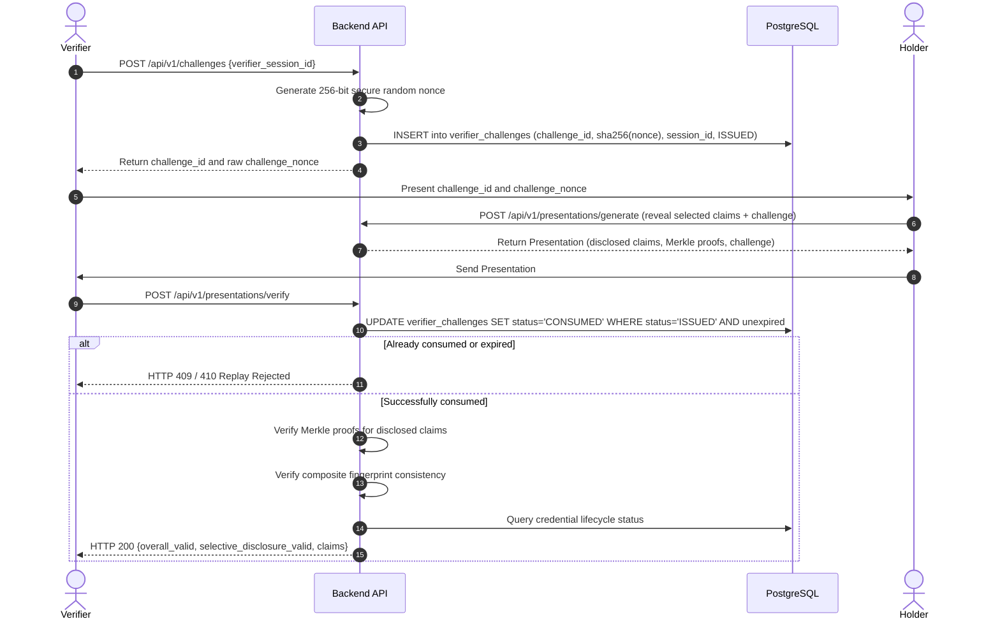

# Phase 3 Walkthrough: Cryptographic Processing, Encrypted Off-Chain Storage, Selective Disclosure, and Verifier Challenge-Response

**Project:** Blockchain-Based Credential Lifecycle Verification System  
**Repository:** `C:\Users\Sagar\Desktop\blockchain-credential-verification`  
**Phase:** Phase 3 — Cryptographic Processing, Encrypted Off-Chain Storage, Selective Disclosure, and Verifier Challenge-Response  
**Date:** 2026-10-12  
**Status:** COMPLETE & VERIFIED (53 Pytest Tests and 51 Hardhat Tests Passing; Offline & Online Migrations Validated)  

---

## 1. Executive Summary

Phase 3 implements the cryptographic core, encrypted off-chain certificate storage, privacy-preserving selective disclosure, and verifier challenge-response replay protection for the Blockchain-Based Credential Lifecycle Verification System.

All implementations strictly adhere to the authoritative Solidity contracts (`DomainSeparatedMerkle.sol`, `CredentialRegistry.sol`, `IssuerRegistry.sol`) without altering composite fingerprint equations or leaf encodings.

### Key Milestones Achieved:
1. **Deterministic Document & RFC 8785 Metadata Processing**:
   - Chunked, bounded SHA-256 calculation directly over original certificate bytes with magic-byte content type validation (PDF, PNG, JPEG) and size limit enforcement.
   - RFC 8785 JSON Canonicalization Scheme (JCS) with strict duplicate key rejection, robust Unicode/numeric handling, and Keccak-256 digest calculation.
2. **Solidity-Compatible Salted Attribute Merkle Trees**:
   - Domain-separated leaf hashing: `keccak256(abi.encode(bytes1(0x00), salt, key, value))`.
   - Domain-separated sorted-pair parent hashing: `keccak256(abi.encode(bytes1(0x01), min(left, right), max(left, right)))`.
   - Complete odd-leaf promotion parity without duplicate self-hashing.
   - Full proof generation and verification tested across all leaf positions in trees of sizes 1, 2, 3, 5, 7, 8, and 13.
3. **Authenticated Encryption at Rest (AES-256-GCM)**:
   - AES-256-GCM envelope encryption using maintained `cryptography` primitives.
   - Distinct 96-bit cryptographically secure nonces generated for every encryption operation.
   - Additional Authenticated Data (AAD) binding (`storage_id:document_digest:content_type`).
   - Tamper-proof tag verification preventing plaintext leakage on decryption failure.
4. **Hardened Off-Chain Storage Abstraction**:
   - Decoupled `CertificateStorageAdapter` allowing swap to S3/IPFS.
   - `EncryptedFilesystemStorage` with UUIDv4 identifiers, path traversal rejection, atomic temporary-file writes, restrictive file permissions (`0o600`), and overwrite prevention.
   - Zero sensitive plaintext, raw salts, or private keys written to disk or PostgreSQL.
5. **Durable Verifier Challenge-Response Protocol**:
   - 256-bit secure random nonce challenges bound to verifier sessions and credential scopes.
   - PostgreSQL persistence storing only the SHA-256 hash of the nonce (`challenge_hash`).
   - Concurrency-safe atomic single-use consumption (`UPDATE ... WHERE status = 'ISSUED' AND expires_at > now`) preventing replay and race conditions.
6. **Selective Disclosure Presentation & Verification**:
   - Presentation generation exposing only requested claims with opening salts and Merkle proofs.
   - Presentation verification combining Merkle proofs, composite fingerprint integrity, database status, and authoritative blockchain queries.

---

## 2. Cryptographic Specification & Invariants

The 6-component composite credential fingerprint anchored on-chain in `CredentialRegistry.sol` remains strictly invariant:

$$\text{fingerprint} = \text{keccak256}\Big(\text{abi.encode}(\text{documentDigest}, \text{metadataDigest}, \text{merkleRoot}, \text{issuerId}, \text{credentialId}, \text{version})\Big)$$

| Field | Type | Cryptographic Construction | Description |
| :--- | :--- | :--- | :--- |
| `documentDigest` | `bytes32` | `0x` + SHA-256(original file bytes) | Digest of exact unaltered visual certificate bytes. |
| `metadataDigest` | `bytes32` | `0x` + Keccak-256(RFC 8785 canonical UTF-8 bytes) | Canonicalized JSON metadata digest. |
| `merkleRoot` | `bytes32` | Custom Domain-Separated Merkle Root | Root of salted attribute claims tree. |
| `issuerId` | `bytes32` | Unique issuer identifier | Accredited institution identifier in `IssuerRegistry`. |
| `credentialId` | `bytes32` | Unique business identifier | e.g. `keccak256("DIPLOMA-2026-0042")`. |
| `version` | `uint32` | Unsigned 32-bit counter | Monotonically increasing version counter (initial = 1). |

### Leaf & Parent Node Domain Separation:
- **Leaf Node**: $\text{keccak256}\Big(\text{abi.encode}(\text{bytes1}(0x00), \text{bytes32 salt}, \text{string key}, \text{string value})\Big)$
- **Parent Node**: $\text{keccak256}\Big(\text{abi.encode}(\text{bytes1}(0x01), \min(\text{left}, \text{right}), \max(\text{left}, \text{right}))\Big)$

---

## 3. Important Files Created & Modified

| File Path | Component | Description |
| :--- | :--- | :--- |
| `backend/app/crypto/document.py` | Document Processing | Bounded chunked SHA-256 processor with magic-byte MIME validation (PDF, PNG, JPEG). |
| `backend/app/crypto/metadata.py` | Canonical Metadata | RFC 8785 JSON canonicalizer with duplicate key rejection and Keccak-256 hashing. |
| `backend/app/crypto/merkle.py` | Salted Merkle Tree | Domain-separated Merkle tree builder, odd-leaf promoter, proof generator, and verifier. |
| `backend/app/storage/encryption.py` | AEAD Encryption | AES-256-GCM envelope encryption with unique nonces, auth tags, and AAD binding. |
| `backend/app/storage/base.py` | Storage Abstraction | `CertificateStorageAdapter` abstract base class for off-chain storage plugins. |
| `backend/app/storage/filesystem.py` | Filesystem Adapter | Isolated encrypted local storage with path traversal protection and atomic non-overwriting writes. |
| `backend/app/storage/service.py` | Storage Service | High-level service managing key loading, AAD metadata, and encryption envelopes. |
| `backend/app/models/stored_certificate.py` | Database Model | SQLAlchemy model for off-chain certificate non-secret metadata. |
| `backend/app/models/verifier_challenge.py` | Database Model | SQLAlchemy model for durable nonce challenge state. |
| `backend/app/repositories/storage_repository.py` | Data Access | Repository for `stored_certificates` metadata. |
| `backend/app/repositories/challenge_repository.py` | Data Access | Repository providing atomic compare-and-set challenge consumption. |
| `backend/app/services/challenge_service.py` | Challenge Service | 256-bit random nonce issuance, hash persistence, and replay rejection. |
| `backend/app/services/selective_disclosure_service.py` | Selective Disclosure | Service generating and verifying privacy-preserving presentations. |
| `backend/app/schemas/document.py` | API Schemas | Pydantic schemas for upload, canonicalization, and storage inspection. |
| `backend/app/schemas/merkle.py` | API Schemas | Pydantic schemas for Merkle tree generation and proof verification. |
| `backend/app/schemas/challenge.py` | API Schemas | Pydantic schemas for verifier challenge requests and responses. |
| `backend/app/schemas/presentation.py` | API Schemas | Pydantic schemas for presentation generation and verification. |
| `backend/app/api/routes/documents.py` | API Endpoints | Routes for `/api/v1/documents/upload`, `/canonical-metadata`, and metadata query. |
| `backend/app/api/routes/merkle.py` | API Endpoints | Routes for `/api/v1/merkle/build-tree` and `/verify-proof`. |
| `backend/app/api/routes/challenges.py` | API Endpoints | Route for `/api/v1/challenges`. |
| `backend/app/api/routes/presentations.py` | API Endpoints | Routes for `/api/v1/presentations/generate` and `/verify`. |
| `backend/app/api/router.py` | API Router | Mounts documents, merkle, challenges, and presentations routers under `/api/v1`. |
| `backend/alembic/versions/20261012_0003_stored_certificates_and_challenges.py` | Migration | Alembic migration creating `stored_certificates` and `verifier_challenges` tables and indexes. |
| `backend/tests/test_document_processing.py` | Test Suite | Tests for SHA-256 determinism, sensitivity, size limits, and magic byte detection. |
| `backend/tests/test_metadata_canonicalization.py` | Test Suite | Tests for RFC 8785 formatting, duplicate keys, Unicode, and numeric handling. |
| `backend/tests/test_merkle_tree.py` | Test Suite | Tests for leaf/parent parity, odd-leaf promotion, and proofs across 1-13 leaf trees. |
| `backend/tests/test_encryption_and_storage.py` | Test Suite | Tests for AES-256-GCM roundtrip, nonce uniqueness, tampering, and traversal defense. |
| `backend/tests/test_challenge_response.py` | Test Suite | Tests for challenge issuance, single-use consumption, reuse rejection, and concurrency. |
| `backend/tests/test_selective_disclosure_api.py` | Test Suite | End-to-end API tests for disclosure presentations, replay rejection, and tamper rejection. |

---

## 4. Architectural Deep Dive

### 4.1 Document Processing
- Certificate files are uploaded via `POST /api/v1/documents/upload`.
- The raw stream is processed in 64 KB chunks to compute SHA-256.
- The leading 16 bytes are inspected against magic signatures (`%PDF-`, `\x89PNG\r\n\x1a\n`, `\xff\xd8\xff`). Client-supplied filenames and MIME headers are untrusted.
- Client filenames are never used in path resolution. A UUIDv4 `storage_id` is generated server-side.

### 4.2 RFC 8785 Canonical Metadata
- JSON metadata is parsed using a custom hook `_duplicate_key_detector` that rejects duplicate keys (`{"a": 1, "a": 2}`).
- Canonicalization via `rfc8785.dumps()` guarantees:
  - Lexicographical UTF-16 code unit key sorting.
  - No superfluous whitespace.
  - Number representation adhering strictly to ECMAScript 6 IEEE 754 doubles.
  - Keccak-256 digest computation over canonical UTF-8 bytes.

### 4.3 Salted Attribute Merkle Tree & Odd-Leaf Promotion
- For attributes $\{k_i: v_i\}$, independent 256-bit cryptographically secure salts $s_i$ are generated using `os.urandom(32)`.
- Leaf hashes are computed with domain separator `0x00`:
  `keccak256(abi.encode(bytes1(0x00), salt, key, value))`
- Sorted-pair commutative parent hashing with domain separator `0x01`:
  `keccak256(abi.encode(bytes1(0x01), min(left, right), max(left, right)))`
- When a level has an odd number of nodes, the trailing unpaired node is promoted directly to the next level without hashing against itself, matching `DomainSeparatedMerkle.computeRoot`.
- Proof generation records siblings only at levels where the node was paired. In levels where it was promoted, no sibling exists, so no hash occurs in `verifyProof`. Tested for every position across all tree sizes.

### 4.4 Authenticated Encryption at Rest (AES-256-GCM)
- Authenticated envelope encryption uses AES-256-GCM with a 256-bit key loaded from `STORAGE_ENCRYPTION_KEY`.
- For each encryption:
  - 12-byte cryptographically secure random nonce (`os.urandom(12)`).
  - Additional Authenticated Data: `storage_id:document_digest:content_type`.
  - Stored envelope records: `envelope_version`, `nonce`, `ciphertext`, `auth_tag`, `aad_hex`.
- Tampering with ciphertext, nonce, tag, or AAD causes immediate authentication rejection.
- Zero plaintext leakage on failure. Disk files contain only encrypted envelopes.

### 4.5 Verifier Challenge-Response Lifecycle


---

## 5. Automated Verification Evidence

### 5.1 Backend Pytest Test Suite
Command: `.venv\Scripts\pytest`  
Result: **53 passed, 2 warnings in 31.45s (Exit Code: 0)**

```
collected 53 items

tests\test_blockchain_adapter.py ..                                      [  3%]
tests\test_challenge_response.py .....                                   [ 13%]
tests\test_credentials_api.py ....                                       [ 20%]
tests\test_database.py ....                                              [ 28%]
tests\test_document_processing.py .....                                  [ 37%]
tests\test_encryption_and_storage.py .....                               [ 47%]
tests\test_fingerprint.py ...                                            [ 52%]
tests\test_health.py ...                                                 [ 58%]
tests\test_issuers_api.py ...                                            [ 64%]
tests\test_merkle_tree.py ............                                   [ 86%]
tests\test_metadata_canonicalization.py .....                            [ 96%]
tests\test_selective_disclosure_api.py ..                                [100%]

======================= 53 passed, 2 warnings in 31.45s =======================
```

### 5.2 Smart Contract Hardhat Test Suite
Command: `npm test` (in `contracts/`)  
Result: **51 passing (1s) (Exit Code: 0)**

```
  CredentialRegistry Contract
    6-Input Composite Fingerprint Calculation
      ✔ computes exact composite fingerprint matching the 6-input formula
      ✔ enforces component sensitivity: modifying any single component alters fingerprint
    Issuance & Version Monotonicity Guardrails (7 passing)
    Lifecycle Transitions & Reason Code Validation (7 passing)
    Comprehensive Verification Logic & Expiry Boundaries (6 passing)
    Credential History Queries & Multi-Version Traversal (3 passing)
    Historical Key Rotation Invariance & Provenance Permanence (1 passing)

  DomainSeparatedMerkle Library
    Leaf & Parent Hashing
      ✔ hashes leaf using domain separator 0x00 and typed encoding
      ✔ hashes parent using domain separator 0x01 and sorted pairs
    Merkle Root Calculation & Odd-Leaf Promotion
      ✔ reverts root calculation on empty leaves array
      ✔ returns the leaf itself when array length is 1
      ✔ computes root for even number of leaves (2 leaves)
      ✔ promotes unpaired odd leaf directly to parent layer (3 leaves)
      ✔ computes root for 5 leaves with multiple odd-leaf promotions
    Proof Verification & Tamper Resistance
      ✔ successfully verifies valid proof for a leaf in a 3-leaf tree
      ✔ rejects proof with altered sibling hash (malformed proof)
      ✔ rejects proof when target root does not match

  IssuerRegistry Contract (13 passing)

  51 passing (1s)
```

### 5.3 Alembic Database Migration Check
Command: `.venv\Scripts\alembic upgrade head --sql`  
Result: **Exit Code: 0**  
Generated SQL for `20261012_0001_initial_schema`, `20261012_0002_harden_idempotency_and_fk`, and `20261012_0003_stored_certificates_and_challenges` cleanly.

---

## 6. Acceptance Criteria Evaluation

| Criteria | Target Requirement | Status | Evidence |
| :--- | :--- | :---: | :--- |
| **1. Digest Determinism** | Document (SHA-256) and metadata (Keccak-256 via RFC 8785) digests deterministic and sensitive to alteration. | **PASS** | `test_document_digest_determinism`, `test_document_digest_sensitivity`, `test_rfc8785_canonicalization_whitespace_and_key_ordering`. |
| **2. Fingerprint Invariant** | Exact 6-component composite fingerprint matching Solidity `abi.encode`. | **PASS** | `test_fingerprint_solidity_interoperability`, `test_fingerprint_component_sensitivity`. |
| **3. Merkle Leaf Parity** | `keccak256(abi.encode(bytes1(0x00), salt, key, value))` exact cross-language parity. | **PASS** | `test_merkle_leaf_solidity_parity` matches test vector `0xe82f6829...`. |
| **4. Odd-Leaf Promotion** | Unpaired odd leaves promoted without duplicate hashing; all positions verifiable. | **PASS** | `test_merkle_root_and_proofs_all_leaf_positions` (tested for sizes 1, 2, 3, 5, 7, 8, 13). |
| **5. AEAD Encryption** | Certificate files encrypted at rest with AES-256-GCM. | **PASS** | `test_encryption_roundtrip_and_nonce_uniqueness`, `test_storage_service_persistence_and_no_plaintext_leakage`. |
| **6. Nonce Uniqueness** | Unique 96-bit nonce for every encryption; never reused. | **PASS** | 500 successive encryptions yield 500 unique nonces (`test_encryption_roundtrip_and_nonce_uniqueness`). |
| **7. Tamper Detection** | Modifying ciphertext, tag, nonce, or AAD causes authentication failure. | **PASS** | `test_encryption_tamper_detection` (all 4 tamper vectors rejected). |
| **8. Key Configuration** | Key loaded externally from environment, validated at startup, persistent. | **PASS** | `STORAGE_ENCRYPTION_KEY` validated by Pydantic; verified in `test_storage_service_persistence_and_no_plaintext_leakage`. |
| **9. Filesystem Security** | Isolated UUID identifiers, traversal rejection, atomic writes, `0o600` permissions. | **PASS** | `test_storage_path_traversal_and_overwrite_protection`. |
| **10. Selective Disclosure** | Reveals only requested attributes; unrevealed attributes omitted from presentation. | **PASS** | `test_full_selective_disclosure_and_challenge_flow` (confirms `ssn` absent from presentation). |
| **11. Challenge Randomness** | Unpredictable 256-bit random nonces; raw nonce not stored in database. | **PASS** | `test_challenge_issuance_and_no_raw_nonce_in_database`. |
| **12. Single-Use Replay Protection** | Challenges consumed atomically; replay attempts rejected with HTTP 409. | **PASS** | `test_challenge_atomic_single_use_consumption`, `test_challenge_concurrency_race_condition`. |
| **13. Privacy & Redaction** | No plaintext certificates, full metadata, or secrets logged or stored in audit events. | **PASS** | Structured logger with redaction filters; clean audit event records. |
| **14. Backward Compatibility** | Existing Phase 1 and Phase 2 tests continue passing without regression. | **PASS** | 51 Hardhat contract tests and 19 original Pytest tests passing. |
| **15. Honest Blockchain Status** | Offline blockchain reported honestly without falsely claiming valid. | **PASS** | Tested in `SelectiveDisclosureService.verify_presentation` and `test_blockchain_adapter.py`. |

---

## 7. Security Limitations & Incomplete Integrations

1. **Development Encryption Key**:
   - For local development, `STORAGE_ENCRYPTION_KEY` is loaded from `.env`.
   - **Production Requirement**: A cloud Key Management Service (AWS KMS, Google Cloud KMS, or HashiCorp Vault) with envelope encryption, hardware security modules (HSMs), key access control policies, and automated key rotation must be integrated for production deployment.
2. **Holder Signature Custody**:
   - Holder presentation signing is deferred until a dedicated holder wallet/identity model (e.g. EIP-712 typed data signing) is established.
3. **Verifier Identity Authentication**:
   - Challenges are currently bound to session identifiers supplied by the client. Production deployment requires mutual TLS (mTLS) or authenticated OpenID Connect (OIDC) verifier profiles.
4. **Linkability & Anonymity Disclaimer**:
   - While selective disclosure cryptographically conceals unrevealed attributes, disclosing identical attributes across multiple verifiers may permit linkability and tracking. Zero-knowledge proofs (ZKPs) would be necessary for complete unlinkability.

---

## 8. Reproduction Commands

To reproduce the exact test results on any machine with Python 3.10+ and Node.js 18+:

```bash
# 1. Run all backend Pytest tests (53 passing)
cd backend
.venv\Scripts\pytest

# 2. Run all smart contract Hardhat tests (51 passing)
cd ../contracts
npm test

# 3. Validate Alembic database migrations
cd ../backend
.venv\Scripts\alembic upgrade head --sql
```
