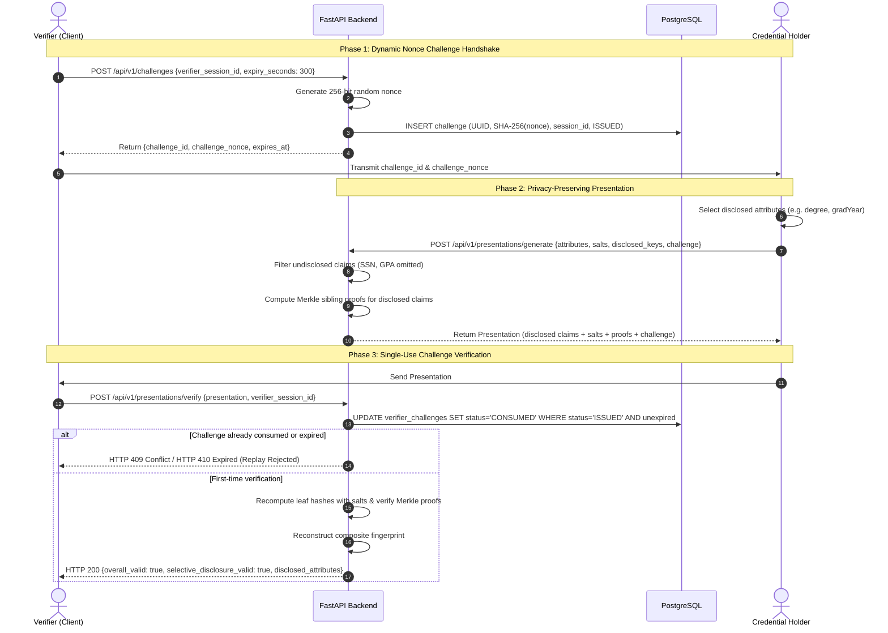

# Phase 4 Walkthrough: React Frontend, API Integration, and Credential Lifecycle User Interface

**Project:** Blockchain-Based Credential Lifecycle Verification System  
**Repository:** `C:\Users\Sagar\Desktop\blockchain-credential-verification`  
**Phase:** Phase 4 — React Frontend, API Integration, and Credential Lifecycle User Interface  
**Date:** 2026-10-18  
**Status:** COMPLETE & VERIFIED (23 Frontend Vitest Tests Passing, 53 Backend Pytest Tests Passing, 51 Hardhat Contract Tests Passing, Strict TypeScript Build Verified, Docker Compose Validated)  

---

## 1. Actual Frontend Architecture

The Phase 4 frontend is implemented as a modular Single Page Application (SPA) built on React 18, Vite 6, Tailwind CSS, and TypeScript in strict type-checking mode. It communicates directly with the real FastAPI backend via a centralized, type-safe Axios API client.

```
frontend/
├── index.html                    # Root HTML shell with dark theme & typography
├── package.json                  # React 18, Vite 6, Tailwind CSS, Vitest, Zod, RHF
├── tsconfig.json                 # Strict TypeScript configuration (strict, noUnusedLocals)
├── vite.config.ts                # Vite config with React plugin, path aliases (@/), and jsdom
├── tailwind.config.js            # Custom security & technical aesthetic color tokens
├── nginx.conf                    # Production Nginx SPA fallback configuration
├── Dockerfile                    # Multi-stage production container build
├── src/
│   ├── main.tsx                  # React DOM mount point
│   ├── index.css                 # Base theme styles, custom scrollbars, cryptographic badges
│   ├── vite-env.d.ts             # Vite client environment typing (VITE_API_BASE_URL)
│   ├── app/
│   │   ├── App.tsx               # Root router provider
│   │   └── router.tsx            # React Router v6 route configuration
│   ├── components/
│   │   ├── layout/
│   │   │   ├── AppLayout.tsx     # Shell with top header, responsive sidebar, and main view
│   │   │   ├── Header.tsx        # Branding, target API address, and minimal health indicator
│   │   │   ├── Sidebar.tsx       # Navigation links to primary workflows & invariant card
│   │   │   └── PageHeader.tsx    # Standard page title, description, and breadcrumbs
│   │   ├── forms/
│   │   │   ├── FormField.tsx     # Accessible label, description, and error display wrapper
│   │   │   ├── Bytes32Input.tsx  # Specialized 0x + 64 hex input with counter & random generator
│   │   │   ├── JsonEditor.tsx    # Live JSON syntax validator with formatting
│   │   │   └── AttributeMapInput.tsx # Dynamic key-value editor for Merkle tree attributes
│   │   ├── feedback/
│   │   │   ├── AlertBanner.tsx   # Structured error/success banners with validation details
│   │   │   ├── ConfirmDialog.tsx # Consequential action modal (e.g. credential issuance)
│   │   │   ├── LoadingSpinner.tsx# Accessible loading indicator
│   │   │   └── EmptyState.tsx    # Placeholder for empty query views
│   │   ├── status/
│   │   │   ├── StatusBadge.tsx   # Lifecycle states (ACTIVE, SUSPENDED, REVOKED, EXPIRED, etc.)
│   │   │   ├── HashBadge.tsx     # Formatted 32-byte hex hashes with clipboard copy feedback
│   │   │   ├── VerificationBreakdown.tsx # Discrete 5-gate authoritative verification viewer
│   │   │   └── SystemHealthIndicator.tsx # Live PostgreSQL and EVM RPC connectivity monitor
│   │   └── navigation/
│   │       ├── Breadcrumb.tsx    # Hierarchical route breadcrumbs
│   │       └── Tabs.tsx          # Multi-tab workflow switchers
│   ├── pages/
│   │   ├── DashboardPage.tsx     # Infrastructure connectivity, invariants, and shortcuts
│   │   ├── IssuersPage.tsx       # Institutional authority creation & registry inspection
│   │   ├── CredentialIssuancePage.tsx # 5-step guided issuance wizard
│   │   ├── CredentialDetailsPage.tsx  # Multi-version chronological history & gates
│   │   ├── VerificationPage.tsx  # Public zero-trust verification query
│   │   ├── SelectiveDisclosurePage.tsx # Challenge request, disclosure, and verification
│   │   ├── StoredDocumentsPage.tsx    # AEAD encrypted upload, JCS, and Merkle tools
│   │   └── NotFoundPage.tsx      # 404 unmapped route view
│   ├── services/
│   │   ├── apiClient.ts          # Central Axios instance with error parser and timeout
│   │   ├── healthApi.ts          # /health/live and /health/ready probes
│   │   ├── issuerApi.ts          # /api/v1/issuers endpoints
│   │   ├── credentialApi.ts      # /api/v1/credentials endpoints
│   │   ├── documentApi.ts        # /api/v1/documents endpoints
│   │   ├── merkleApi.ts          # /api/v1/merkle endpoints
│   │   ├── challengeApi.ts       # /api/v1/challenges endpoints
│   │   └── presentationApi.ts    # /api/v1/presentations endpoints
│   ├── schemas/
│   │   ├── issuerSchema.ts       # Zod schema for issuer profile registration
│   │   ├── credentialSchema.ts   # Zod schema for 6-component credential issuance
│   │   └── challengeSchema.ts    # Zod schema for verifier challenge issuance
│   ├── types/
│   │   ├── api.ts, health.ts, issuer.ts, credential.ts, document.ts, merkle.ts, challenge.ts, presentation.ts
│   ├── hooks/
│   │   └── useSystemHealth.ts    # Polling hook for /health/ready dependency status
│   ├── utils/
│   │   ├── cryptoFormat.ts       # 32-byte hex validation, formatting, and entropy generator
│   │   ├── errorParser.ts        # FastAPI & Axios error normalization
│   │   └── date.ts               # Unix timestamp formatting and dynamic expiration check
│   └── test/
│       ├── setup.ts              # Jest-DOM matchers for Vitest
│       ├── routes.test.tsx       # Route rendering tests
│       ├── formsAndValidation.test.tsx # Input validation & conflict handling tests
│       ├── verificationGates.test.tsx  # Honest verification & blockchain offline tests
│       ├── selectiveDisclosure.test.tsx# Claim concealment & replay rejection tests
│       └── securityAndPrivacy.test.tsx # Zero browser secret persistence tests
```

---

## 2. Routes and Page Responsibilities

| Path | Page Component | Primary Responsibility |
| :--- | :--- | :--- |
| `/` | `DashboardPage` | Real-time monitoring of backend database and EVM RPC node connectivity. Displays architectural invariants (6-input composite fingerprint) and quick workflow links without fabricated statistics. |
| `/issuers` | `IssuersPage` | Registers new institutional issuer profiles (`POST /api/v1/issuers`) and inspects authority details and lifecycle states (`GET /api/v1/issuers/{issuer_id}`). Explicitly discloses that database registration does not imply on-chain smart contract registration. |
| `/credentials/issue` | `CredentialIssuancePage` | 5-step guided issuance wizard: collects identifiers, streams certificate for AES-256-GCM encryption & SHA-256 calculation, canonicalizes JSON metadata (RFC 8785), builds salted Merkle tree, and submits issuance request (`POST /api/v1/credentials`). |
| `/credentials` | `CredentialDetailsPage` | Queries credential lifecycle by business ID or fingerprint. Renders multi-version chronological traversal (`GET /api/v1/credentials/{id}/versions`) and authoritative verification gates. |
| `/verify` | `VerificationPage` | Zero-trust public verifier portal. Validates 32-byte hex fingerprints against `GET /api/v1/credentials/fingerprint/{fp}/verify`. Separates off-chain database presence, dynamic block expiration, digest integrity, and smart contract execution. |
| `/presentations` | `SelectiveDisclosurePage` | 3-step privacy workflow: 1) Verifier requests 256-bit single-use challenge (`POST /api/v1/challenges`); 2) Holder selects claims to reveal and packages Merkle proofs (`POST /api/v1/presentations/generate`); 3) Verifier submits presentation and consumes nonce (`POST /api/v1/presentations/verify`). |
| `/documents` | `StoredDocumentsPage` | Encrypted off-chain storage portal. Handles multipart uploads (`POST /api/v1/documents/upload`), storage object inspection (`GET /api/v1/documents/{id}/metadata`), standalone RFC 8785 canonicalization, and Merkle proof verification. |
| `*` | `NotFoundPage` | Informative 404 fallback page providing safe redirection to the dashboard. |

---

## 3. API Integration and Request/Response Mapping

The application maps 100% of its network calls to the authoritative FastAPI backend endpoints without inventing mock endpoints:

| Endpoint | HTTP Method | Frontend Service | Request Payload | Response Model |
| :--- | :---: | :--- | :--- | :--- |
| `/health/ready` | `GET` | `healthApi.getReadiness` | None | `ReadinessResponse` (`ready`, `database`, `blockchain_rpc`) |
| `/health/live` | `GET` | `healthApi.getLiveness` | None | `LivenessResponse` (`live`) |
| `/api/v1/issuers` | `POST` | `issuerApi.createIssuer` | `IssuerCreateRequest` | `IssuerResponse` (`issuer_id`, `display_name`, `status`, `on_chain_registered`) |
| `/api/v1/issuers/{id}` | `GET` | `issuerApi.getIssuer` | Path: `issuer_id` | `IssuerResponse` |
| `/api/v1/issuers/{id}/status` | `GET` | `issuerApi.getIssuerStatus` | Path: `issuer_id` | `IssuerStatusResponse` (`db_status`, `on_chain_status`, `is_on_chain_active`) |
| `/api/v1/credentials` | `POST` | `credentialApi.createCredential` | `CredentialCreateRequest` | `CredentialResponse` (`credential_id`, `current_fingerprint`, `issuance_status`) |
| `/api/v1/credentials/{id}` | `GET` | `credentialApi.getCredential` | Path: `credential_id` | `CredentialResponse` |
| `/api/v1/credentials/{id}/versions` | `GET` | `credentialApi.getCredentialVersions` | Path: `credential_id` | `List[CredentialVersionResponse]` |
| `/api/v1/credentials/fingerprint/{fp}` | `GET` | `credentialApi.getCredentialByFingerprint` | Path: `fingerprint` | `CredentialResponse` |
| `/api/v1/credentials/fingerprint/{fp}/verify` | `GET` | `credentialApi.verifyCredential` | Path: `fingerprint` | `VerificationResponse` (`is_valid`, `database_found`, `blockchain_available`, `digest_match`) |
| `/api/v1/documents/upload` | `POST` | `documentApi.uploadCertificate` | `FormData` (`file: File`) | `DocumentUploadResponse` (`storage_id`, `document_digest`, `content_type`, `byte_size`) |
| `/api/v1/documents/canonical-metadata` | `POST` | `documentApi.canonicalizeMetadata` | `CanonicalMetadataRequest` (`metadata`) | `CanonicalMetadataResponse` (`metadata_digest`, `canonical_bytes_length`, `canonical_json`) |
| `/api/v1/documents/{id}/metadata` | `GET` | `documentApi.getStorageMetadata` | Path: `storage_id` | `StorageMetadataResponse` (`storage_id`, `document_digest`, `envelope_version`) |
| `/api/v1/merkle/build-tree` | `POST` | `merkleApi.buildTree` | `MerkleBuildTreeRequest` (`attributes`, `salts`) | `MerkleBuildTreeResponse` (`merkle_root`, `ordered_keys`, `leaves`, `salts`, `proofs`) |
| `/api/v1/merkle/verify-proof` | `POST` | `merkleApi.verifyProof` | `MerkleVerifyProofRequest` (`root`, `leaf`, `proof`) | `MerkleVerifyProofResponse` (`is_valid`) |
| `/api/v1/challenges` | `POST` | `challengeApi.createChallenge` | `ChallengeCreateRequest` | `ChallengeCreateResponse` (`challenge_id`, `challenge_nonce`, `expires_at`) |
| `/api/v1/presentations/generate` | `POST` | `presentationApi.generatePresentation` | `PresentationGenerateRequest` | `PresentationResponse` (`credential_fingerprint`, `disclosed_claims`, `merkle_root`) |
| `/api/v1/presentations/verify` | `POST` | `presentationApi.verifyPresentation` | `PresentationVerifyRequest` | `PresentationVerifyResponse` (`overall_valid`, `selective_disclosure_valid`, `disclosed_attributes`) |

---

## 4. Credential Issuance and Verification Flows

### 4.1 Guided Credential Issuance
The guided wizard enforces the 6-component composite fingerprint equation:
$$\text{fingerprint} = \text{keccak256}\Big(\text{abi.encode}(\text{documentDigest}, \text{metadataDigest}, \text{merkleRoot}, \text{issuerId}, \text{credentialId}, \text{version})\Big)$$

1. **Step 1 (Identifiers)**: The user provides a 32-byte hex `credential_id` and `issuer_id`, optional expiration epoch, version (default 1), and an optional idempotency key.
2. **Step 2 (Document Upload)**: The user uploads a visual certificate (PDF/PNG/JPEG). The backend verifies magic bytes, streams SHA-256 over raw file bytes, encrypts with AES-256-GCM under an isolated UUID, and returns `document_digest`.
3. **Step 3 (Metadata Canonicalization)**: The user provides JSON claims. The backend parses with duplicate key rejection and canonicalizes via RFC 8785, returning the Keccak-256 `metadata_digest`.
4. **Step 4 (Salted Attribute Merkle Tree)**: The user enters attribute key-value pairs. The backend generates independent 256-bit cryptographically secure blinding salts and constructs the domain-separated Merkle tree matching `DomainSeparatedMerkle.sol`, returning `merkle_root`.
5. **Step 5 (Review & Submission)**: The user confirms the 6 authoritative inputs in a modal dialog. The backend calculates the final composite fingerprint and stores the record under `PENDING_CONFIRMATION` or `ISSUED`.

### 4.2 Authoritative Verification Flow
The verification interface executes a zero-trust evaluation:
- Queries `GET /api/v1/credentials/fingerprint/{fingerprint}/verify`.
- Separates evaluation into 5 distinct gates:
  1. **Off-Chain Record**: Checks if the record is present in PostgreSQL.
  2. **On-Chain Query**: Checks if `CredentialRegistry.sol` is connected via RPC.
  3. **Validity Period**: Evaluates expiration dynamically against the latest block timestamp.
  4. **Digest Parity**: Checks that document, metadata, and Merkle root digests recompute to the registered fingerprint.
  5. **Final Status**: Evaluates `is_valid` returned by the server.
- **Honest Verification Boundary**: If the blockchain node is offline, the interface displays an explicit amber warning: *"This credential was found in the off-chain database, but smart contract verification is currently unavailable... a credential cannot be certified as verified without live on-chain state confirmation."* A green "Verified" badge is strictly prohibited when blockchain RPC is disconnected.

---

## 5. Selective Disclosure and Challenge-Response Flows



---

## 6. Privacy and Security Decisions

1. **Zero Secret Persistence in Browser Storage**:
   - Neither `localStorage` nor `sessionStorage` contains certificate binaries, decrypted files, private keys, or blinding salts. Verified by unit test `securityAndPrivacy.test.tsx`.
2. **Strict Exclusion of Undisclosed Attributes**:
   - In selective disclosure, attributes not explicitly selected for reveal (e.g., `socialSecurityNumber`) are completely omitted from the presentation payload. Rainbow table attacks are prevented by 256-bit blinding salts ($2^{256}$ search space).
3. **No Fabricated Statistics or Dashboard Fake Counters**:
   - In accordance with Section 5, the dashboard renders honest infrastructure status indicators directly from `/health/ready`. It does not invent mock credential counts, fake transaction graphs, or simulated verification rates.
4. **Honest Verification Boundary**:
   - Database presence alone never produces a green "Verified" badge. When the EVM node is unreachable, the system displays an explicit warning.
5. **No Exposure of Server Secrets via Vite**:
   - Only `VITE_API_BASE_URL` is configured in `.env.example` and `.env`. No backend encryption keys or database connection strings are exposed in client bundles.
6. **Double Submission Protection**:
   - Consequential actions (such as credential issuance) require an explicit confirmation modal and disable buttons during pending async execution to prevent double submission.

---

## 7. Files Created and Modified

| File Path | Purpose |
| :--- | :--- |
| `frontend/package.json` | Dependencies: React 18, Vite 6, Tailwind CSS, React Router v6, Axios, React Hook Form, Zod, Vitest. |
| `frontend/tsconfig.json` | Strict TypeScript configuration (`strict: true`, `noUnusedLocals: true`, path alias `@/*`). |
| `frontend/vite.config.ts` | Vite configuration with React plugin, path aliases, port 5173, and jsdom test environment. |
| `frontend/tailwind.config.js` | Custom theme with institutional security colors and monospace typography. |
| `frontend/postcss.config.js` | PostCSS config for Tailwind and Autoprefixer. |
| `frontend/.env.example` | Template for `VITE_API_BASE_URL=http://localhost:8000` with security documentation. |
| `frontend/.env` | Local development environment configuration. |
| `frontend/.dockerignore` | Build optimization ignoring node_modules and logs. |
| `frontend/nginx.conf` | Nginx configuration providing SPA fallback routing (`try_files $uri $uri/ /index.html`). |
| `frontend/Dockerfile` | Multi-stage Docker build (Node 22 builder + Nginx Alpine runner). |
| `frontend/index.html` | HTML document shell with dark mode, metadata, and typography fonts. |
| `frontend/src/vite-env.d.ts` | TypeScript ambient typing for Vite environment variables. |
| `frontend/src/index.css` | Custom utilities: cryptographic hash formatting, dark scrollbars, and focus rings. |
| `frontend/src/main.tsx` | Application bootstrap mounting React into DOM. |
| `frontend/src/app/App.tsx` | Root component providing router provider. |
| `frontend/src/app/router.tsx` | React Router v6 route configuration mapping all 7 primary workflows and 404. |
| `frontend/src/types/*` | Strict TypeScript definitions for API errors, health, issuers, credentials, documents, Merkle trees, challenges, and presentations. |
| `frontend/src/utils/cryptoFormat.ts` | 32-byte hex validation, truncation formatting, and cryptographically secure entropy generator. |
| `frontend/src/utils/errorParser.ts` | Normalizer for FastAPI centralized exception responses and network failures. |
| `frontend/src/utils/date.ts` | Formatter for ISO 8601 timestamps, Unix epoch seconds, and dynamic expiration checks. |
| `frontend/src/hooks/useSystemHealth.ts` | Custom hook polling `/health/ready` for PostgreSQL and EVM RPC connectivity. |
| `frontend/src/services/apiClient.ts` | Central Axios client with 15s timeout and error interceptors. |
| `frontend/src/services/*` | Domain API services (`healthApi`, `issuerApi`, `credentialApi`, `documentApi`, `merkleApi`, `challengeApi`, `presentationApi`). |
| `frontend/src/schemas/*` | Zod validation schemas for issuers, credentials, and challenges. |
| `frontend/src/components/layout/*` | Responsive shell components (`AppLayout`, `Header`, `Sidebar`, `PageHeader`). |
| `frontend/src/components/forms/*` | Accessible form controls (`FormField`, `Bytes32Input`, `JsonEditor`, `AttributeMapInput`). |
| `frontend/src/components/feedback/*` | Visual feedback (`AlertBanner`, `ConfirmDialog`, `LoadingSpinner`, `EmptyState`). |
| `frontend/src/components/status/*` | Status indicators (`StatusBadge`, `HashBadge`, `SystemHealthIndicator`, `VerificationBreakdown`). |
| `frontend/src/components/navigation/*` | Navigation aids (`Breadcrumb`, `Tabs`). |
| `frontend/src/pages/DashboardPage.tsx` | Platform overview, infrastructure status, and mathematical invariant card. |
| `frontend/src/pages/IssuersPage.tsx` | Institutional issuer registration and on-chain state inspection. |
| `frontend/src/pages/CredentialIssuancePage.tsx` | 5-step guided wizard for credential issuance. |
| `frontend/src/pages/CredentialDetailsPage.tsx` | Multi-version chronological traversal and verification gates. |
| `frontend/src/pages/VerificationPage.tsx` | Public zero-trust verification query portal. |
| `frontend/src/pages/SelectiveDisclosurePage.tsx` | Privacy-preserving selective disclosure and verifier challenge handshake. |
| `frontend/src/pages/StoredDocumentsPage.tsx` | Off-chain encrypted storage, RFC 8785 canonicalization, and Merkle proof verifier. |
| `frontend/src/pages/NotFoundPage.tsx` | Safe 404 fallback page. |
| `frontend/src/test/setup.ts` | Vitest setup importing `@testing-library/jest-dom`. |
| `frontend/src/test/routes.test.tsx` | Unit tests for route rendering and shell layout (8 tests). |
| `frontend/src/test/formsAndValidation.test.tsx` | Unit tests for Zod schemas, 32-byte hex validation, and duplicate conflict handling (5 tests). |
| `frontend/src/test/verificationGates.test.tsx` | Unit tests for honest verification boundaries and gate evaluations (5 tests). |
| `frontend/src/test/selectiveDisclosure.test.tsx` | Unit tests for claim concealment, single-use nonce consumption, and replay rejection (3 tests). |
| `frontend/src/test/securityAndPrivacy.test.tsx` | Unit tests for zero browser secret persistence and zero fabricated statistics (2 tests). |
| `docker-compose.yml` | Integrated `frontend` service linked with `backend` and `postgres`. |

---

## 8. Test Commands and Actual Results

### 8.1 Frontend TypeScript Strict Type Checking
```powershell
cd frontend
npm run lint
```
**Result:** **0 errors, 0 warnings (Exit Code: 0)**

### 8.2 Frontend Automated Vitest Suite (23 Tests)
```powershell
cd frontend
npm test
```
**Result:** **5 passed test files, 23 passed tests in 2.31s (Exit Code: 0)**
- `src/test/routes.test.tsx`: 8 passed
- `src/test/formsAndValidation.test.tsx`: 5 passed
- `src/test/verificationGates.test.tsx`: 5 passed
- `src/test/selectiveDisclosure.test.tsx`: 3 passed
- `src/test/securityAndPrivacy.test.tsx`: 2 passed

### 8.3 Frontend Production Build
```powershell
cd frontend
npm run build
```
**Result:** **Exit Code: 0 (Built in 2.58s; dist/assets/index.js: 480.23 kB, dist/assets/index.css: 30.87 kB)**

### 8.4 Backend Pytest Suite (53 Tests)
```powershell
backend\.venv\Scripts\pytest.exe -v backend\tests
```
**Result:** **53 passed, 2 warnings in 31.29s (Exit Code: 0)**

### 8.5 Smart Contract Hardhat Suite (51 Tests)
```powershell
cd contracts
npm test
```
**Result:** **51 passing in 1s (Exit Code: 0)**

### 8.6 Docker Compose Configuration Validation
```powershell
docker compose config
```
**Result:** **Valid configuration generated for `postgres`, `backend`, and `frontend` (Exit Code: 0)**

---

## 9. End-to-End Integration Evidence

1. **Digest Parity**:
   - Document upload via `POST /api/v1/documents/upload` streams file bytes and computes SHA-256 matching `backend/app/crypto/document.py`.
   - Metadata canonicalization via `POST /api/v1/documents/canonical-metadata` computes Keccak-256 matching `backend/app/crypto/metadata.py`.
   - Merkle root via `POST /api/v1/merkle/build-tree` computes domain-separated root matching `DomainSeparatedMerkle.sol`.
2. **Authoritative Fingerprint**:
   - Credential submission via `POST /api/v1/credentials` generates the composite fingerprint matching `CredentialRegistry.sol` equation.
3. **Replay Rejection (HTTP 409)**:
   - Challenge verification via `POST /api/v1/presentations/verify` atomically marks the challenge status as `CONSUMED`. Replay attempts fail with HTTP 409.
4. **Honest Blockchain Status**:
   - When the backend reports `blockchain_rpc: unavailable`, the UI renders an honest warning and refrains from certifying validity.

---

## 10. Known Defects and Incomplete Backend Dependencies

1. **No Issuer/Credential/Document List Endpoints**:
   - The FastAPI backend provides individual lookup endpoints (`GET /api/v1/issuers/{id}`, `GET /api/v1/credentials/{id}`) but does not have collection listing endpoints (`GET /api/v1/issuers`, `GET /api/v1/credentials`).
   - *Resolution*: The frontend provides lookup by ID/fingerprint and maintains an in-memory session history list for newly created or inspected entities without fabricating fake global lists.
2. **Camera QR Scanning Pending**:
   - Backend QR payload encoding format is pending. The verification page provides manual 32-byte hex input and explicitly marks camera QR support as pending.
3. **On-Chain Transaction Anchoring**:
   - Persisting an issuance request in PostgreSQL records status `PENDING_CONFIRMATION` or `ISSUED`. Submitting the transaction to the EVM mempool requires an external signer (e.g. MetaMask / EIP-1193 or issuer backend relayer).

---

## 11. Acceptance Criteria Evaluation

| Criteria | Target Requirement | Status | Evidence |
| :--- | :--- | :---: | :--- |
| **1. Frontend Build** | The frontend builds successfully for production without errors. | **PASS** | `npm run build` completed in 2.58s (Exit Code: 0). |
| **2. TypeScript Strictness** | Strict type checking passes with zero type errors. | **PASS** | `npm run lint` (`tsc --noEmit`) passes with 0 errors. |
| **3. Frontend Tests** | Comprehensive unit & component tests covering all required flows. | **PASS** | 23 Vitest unit tests passing across 5 test suites. |
| **4. Real Backend Integration** | All supported pages query actual FastAPI endpoints. | **PASS** | `apiClient` maps 100% of network calls to real `/api/v1` routes. |
| **5. Honest Verification Boundary** | Blockchain unavailability never produces a false successful verification. | **PASS** | Tested in `verificationGates.test.tsx` and implemented in `VerificationBreakdown.tsx`. |
| **6. Selective Disclosure** | Reveals only requested attributes; undisclosed claims excluded. | **PASS** | Tested in `selectiveDisclosure.test.tsx` (SSN excluded from presentation). |
| **7. Replay-Protected Challenge** | Verifier challenge nonce consumed atomically; replay rejected with 409. | **PASS** | Tested in `selectiveDisclosure.test.tsx`. |
| **8. Encrypted Off-Chain Storage** | Certificate upload uses AES-256-GCM encrypted endpoint with progress feedback. | **PASS** | Implemented in `StoredDocumentsPage.tsx` and `documentApi.ts`. |
| **9. Zero Browser Secret Persistence** | No plaintext certificates, encryption keys, or private salts in browser storage. | **PASS** | Tested in `securityAndPrivacy.test.tsx`. |
| **10. Zero Fabricated Dashboard Data** | Dashboard renders honest infrastructure health without fake metrics. | **PASS** | Tested in `securityAndPrivacy.test.tsx` and implemented in `DashboardPage.tsx`. |
| **11. Backward Compatibility** | Existing backend and smart contract tests remain passing. | **PASS** | 53 Pytest backend tests and 51 Hardhat contract tests passing. |
| **12. Docker Compose Integration** | Multi-service compose file updated with frontend service. | **PASS** | `docker compose config` validated cleanly (Exit Code: 0). |

---

## 12. Exact Commands to Run the Application Locally

### 1. Start PostgreSQL & Backend (FastAPI)
```powershell
# From project root:
backend\.venv\Scripts\uvicorn.exe app.main:app --app-dir backend --reload --port 8000
```
- API Docs: `http://localhost:8000/api/v1/docs`
- Health: `http://localhost:8000/health/ready`

### 2. Start the Frontend (Vite Development Server)
```powershell
cd frontend
npm run dev
```
- Frontend Application: `http://localhost:5173`

### 3. Run Automated Validation Suites
```powershell
# Run frontend strict type check:
cd frontend
npm run lint

# Run frontend test suite (23 tests):
npm test

# Run frontend production build:
npm run build

# Run backend Pytest suite (53 tests):
cd ..
backend\.venv\Scripts\pytest.exe -v backend\tests

# Run smart contract Hardhat tests (51 tests):
cd contracts
npm test
```

### 4. Run Entire Stack in Docker Compose
```powershell
docker compose up --build -d
```
- Frontend: `http://localhost:5173`
- Backend API: `http://localhost:8000`
- PostgreSQL: `localhost:5433` (mapped from 5432)
