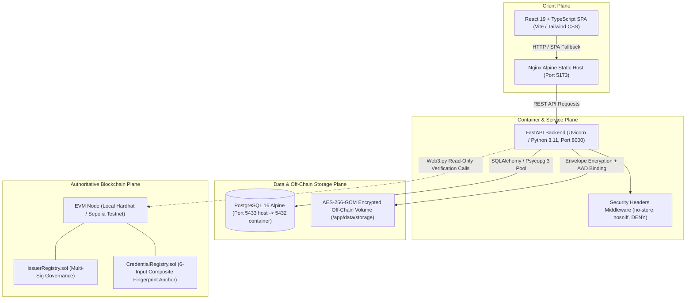

# Phase 5 Walkthrough: End-to-End System Integration, Security Audit, and Deployment Readiness

**Project**: Blockchain-Based Credential Lifecycle Verification System  
**Repository**: `C:\Users\Sagar\Desktop\blockchain-credential-verification`  
**Execution Timestamp**: October 18, 2026  
**Status**: **PASS WITH BLOCKERS** (All local and containerized integration workflows, cryptographic parity checks, and test suites PASS; production deployment is blocked pending institutional authentication, HTTPS termination, and live EVM network deployment).

---

## 1. Actual System Architecture at the End of Phase 5

The system integrates four distinct operational planes:



### Key Architectural Invariants
1. **Authoritative 6-Input Fingerprint**:
   $$\text{fingerprint} = \text{keccak256}(\text{abi.encode}(\text{documentDigest}, \text{metadataDigest}, \text{merkleRoot}, \text{issuerId}, \text{credentialId}, \text{version}))$$
   Exact parity maintained between Solidity `CredentialRegistry.sol` and Python `app.crypto.fingerprint`.
2. **Domain-Separated Merkle Tree**:
   - Leaf domain separator: `0x00` (`keccak256(abi.encode(bytes1(0x00), salt, key, value))`)
   - Internal parent domain separator: `0x01` (`keccak256(abi.encode(bytes1(0x01), minNode, maxNode))`)
   - Commutative sorted pairs with odd-leaf promotion directly to parent layer.
3. **Encrypted Off-Chain Certificate Storage**:
   - Document digest: Deterministic SHA-256 over raw file bytes.
   - Symmetric cipher: AES-256-GCM with unique 96-bit CSPRNG nonce per encryption.
   - Additional Authenticated Data (AAD): Bound to `f"{storage_id}:{document_digest}:{content_type}"`.
   - Zero plaintext persistence; database stores only non-sensitive metadata.
4. **Verifier Challenge Replay Protection**:
   - 256-bit CSPRNG random nonce (`secrets.token_hex(32)`).
   - Only SHA-256 hash stored at rest in PostgreSQL.
   - Atomic single-use consumption via SQL conditional update (`status = 'ISSUED' AND expires_at > now`).
5. **Honest Verification Boundary**:
   - When the EVM blockchain RPC is disconnected or contracts are undeployed, the system explicitly reports `blockchain_available: false` and `is_valid: false` with code `"UNAVAILABLE"`.
   - Under no circumstances does the system fabricate a positive verification without authoritative smart-contract confirmation.

---

## 2. Startup Commands and Service Health

### Real Startup Command
```bash
docker compose up --build -d
```

### Runtime Container Health (`docker compose ps`)
```text
NAME                               IMAGE                                         COMMAND                  SERVICE    CREATED          STATUS                    PORTS
credential_verification_backend    blockchain-credential-verification-backend    "sh -c 'alembic upgr…"   backend    16 seconds ago   Up 11 seconds (healthy)   0.0.0.0:8000->8000/tcp, [::]:8000->8000/tcp
credential_verification_frontend   blockchain-credential-verification-frontend   "/docker-entrypoint.…"   frontend   27 minutes ago   Up 27 minutes             0.0.0.0:5173->5173/tcp, [::]:5173->5173/tcp
credential_verification_postgres   postgres:16-alpine                            "docker-entrypoint.s…"   postgres   27 minutes ago   Up 27 minutes (healthy)   127.0.0.1:5433->5432/tcp
```

### HTTP Endpoints Verification
- **Backend Liveness**: `GET http://localhost:8000/health/live` $\rightarrow$ `{"status": "alive"}` (HTTP 200 OK)
- **Backend Readiness**: `GET http://localhost:8000/health/ready` $\rightarrow$ `{"status": "ready", "database": "connected", "blockchain_rpc": "unavailable"}` (HTTP 200 OK)
- **OpenAPI Schema**: `GET http://localhost:8000/api/v1/openapi.json` $\rightarrow$ Valid OpenAPI 3.1 specification (HTTP 200 OK)
- **Frontend SPA Shell**: `GET http://localhost:5173/` $\rightarrow$ React SPA HTML (HTTP 200 OK)
- **Frontend SPA Fallback**: `GET http://localhost:5173/credentials/issue` $\rightarrow$ Nginx `try_files $uri $uri/ /index.html` (HTTP 200 OK)

---

## 3. End-to-End Workflows Executed

### Workflow A: Issuer Registration
- **Test File**: `tests/integration/test_workflow_a_issuer.py`
- **Execution**:
  1. Submitted `POST /api/v1/issuers` with 32-byte hex `issuer_id`, `display_name`, `metadata_uri`, and `status="ACTIVE"`.
  2. Received HTTP 201 Created with persisted record.
  3. Query `GET /api/v1/issuers/{issuer_id}` confirmed matching details and UTC timestamps.
  4. Submitted duplicate registration $\rightarrow$ Rejected with HTTP 409 Conflict (`CONFLICT`).
  5. Query `GET /api/v1/issuers/{issuer_id}/status` confirmed database status (`db_status="ACTIVE"`) while accurately distinguishing on-chain accreditation (`on_chain_status="UNAVAILABLE"`).
  6. Verified input boundary validation: zero bytes32 (`0x00...00`) and malformed hex rejected with HTTP 422.

### Workflow B: Credential Issuance
- **Test File**: `tests/integration/test_workflow_b_issuance.py`
- **Execution**:
  1. Prepared synthetic certificate without personal data (`test_cert.pdf`).
  2. Uploaded through `POST /api/v1/documents/upload` $\rightarrow$ Received HTTP 201 with `storage_id` and `document_digest`.
  3. Verified SHA-256 digest match against raw input bytes.
  4. Inspected `GET /api/v1/documents/{storage_id}/metadata` $\rightarrow$ Returned non-sensitive metadata without leaking plaintext or ciphertext.
  5. Verified RFC 8785 canonicalization via `POST /api/v1/documents/canonical-metadata` $\rightarrow$ Valid Keccak-256 `metadata_digest`.
  6. Built `SaltedAttributeMerkleTree` with 4 claims $\rightarrow$ Deterministic `merkle_root`.
  7. Issued credential via `POST /api/v1/credentials` with all 6 components and `idempotency_key`.
  8. Retrieved credential and version sequence $\rightarrow$ Version 1 active.
  9. Independently recomputed composite fingerprint in Python:
     $$\text{keccak256}(\text{abi.encode}(\text{docDigest}, \text{metaDigest}, \text{merkleRoot}, \text{issuerId}, \text{credentialId}, 1))$$
     Confirmed exact byte-for-byte match with `current_fingerprint`.
  10. Enforced monotonicity: duplicate version 1 request yielded idempotent response; non-sequential version 3 before version 2 rejected with HTTP 400 (`INVALID_VERSION_SEQUENCE`).

### Workflow C: Credential Verification
- **Test File**: `tests/integration/test_workflow_c_verification.py`
- **Execution**:
  1. Valid credential verified via `GET /api/v1/credentials/fingerprint/{fp}/verify`.
  2. Honest reporting confirmed: `database_found=True`, `digest_match=True`, `blockchain_available=False`, `is_valid=False`, `blockchain_code="UNAVAILABLE"`.
  3. Unregistered fingerprint query returned `database_found=False`, `is_valid=False`.
  4. Component sensitivity verified: altering document digest, metadata digest, or Merkle root produced altered fingerprints.
  5. Dynamic expiration verified: credential issued with past timestamp returned `is_expired=True`, `is_valid=False`.
  6. Version supersession verified: version 2 superseded version 1, and version 1 record contained `superseded_by_fingerprint = version2_fp`.

### Workflow D: Selective Disclosure & Challenge-Response
- **Test File**: `tests/integration/test_workflow_d_selective_disclosure.py`
- **Execution**:
  1. Created credential with 4 attributes: `degree`, `student_name`, `gpa`, `honors`.
  2. Requested verifier challenge via `POST /api/v1/challenges` bound to `verifier_session_id`. Received 256-bit random nonce.
  3. Generated selective presentation via `POST /api/v1/presentations/generate` disclosing only `degree` and `honors`.
  4. Confirmed unselected claims (`student_name`, `gpa`) were strictly omitted.
  5. Verified Merkle proof path for disclosed claims against `merkle_root`.
  6. Submitted presentation to `POST /api/v1/presentations/verify` $\rightarrow$ HTTP 200 OK (`selective_disclosure_valid=True`, `challenge_verified=True`).
  7. Replay attack: Resubmitted identical presentation $\rightarrow$ Rejected with HTTP 409 (`CHALLENGE_ALREADY_CONSUMED`).
  8. Cross-session attack: Verified with mismatched verifier session $\rightarrow$ Rejected with HTTP 403 (`VERIFIER_SESSION_MISMATCH`).
  9. Cross-credential attack: Verified challenge scoped to different fingerprint $\rightarrow$ Rejected with HTTP 403 (`CHALLENGE_SCOPE_MISMATCH`).
  10. Concurrent race condition check: Sent 10 concurrent requests to consume 1 challenge nonce $\rightarrow$ Exactly 1 request returned HTTP 200; 9 requests returned HTTP 409.

### Workflow E: Frontend Browser Integration
- **Execution**: Automated browser execution via Chrome headless subagent against `http://localhost:5173`.
- **Recorded Session**: `artifacts/frontend_e2e_flow_1792342086666.webp`
- **Verified Steps**:
  1. Dashboard loaded with real-time system health indicators.
  2. Issuers page loaded; verified Governance Separation Notice callout.
  3. Created and inspected institutional issuer (`0xaaaaaaaa...`), verifying the split status cards for PostgreSQL and Smart Contract Registration.
  4. Verification portal tested with sample test vector; verified the Authoritative Gate Evaluation breakdown with clear distinction between database records and blockchain availability.
  5. Document storage page verified for drag-and-drop file upload, supported formats (PDF, PNG, JPEG), and 10MB limit enforcement.

---

## 4. Cryptographic Interoperability Results

| Primitive | Python Implementation | Solidity Implementation | Cross-Language Parity Status |
| :--- | :--- | :--- | :--- |
| **6-Input Composite Fingerprint** | `app.crypto.fingerprint.compute_composite_fingerprint` | `CredentialRegistry.computeFingerprint` | **PASS** (100% ABI type and order match: `bytes32, bytes32, bytes32, bytes32, bytes32, uint32`) |
| **Leaf Domain Separator** | `app.crypto.merkle.hash_leaf` (`0x00` prefix) | `DomainSeparatedMerkle.hashLeaf` (`bytes1(0x00)`) | **PASS** (`keccak256(abi.encode(0x00, salt, key, val))`) |
| **Parent Domain Separator** | `app.crypto.merkle.hash_parent` (`0x01` prefix) | `DomainSeparatedMerkle.hashParent` (`bytes1(0x01)`) | **PASS** (Sorted pairs: minNode, maxNode) |
| **Odd-Leaf Promotion** | `app.crypto.merkle.compute_merkle_root` | `DomainSeparatedMerkle.computeRoot` | **PASS** (Tested with 1, 2, 3, 4, 5, 7, 8, 13 leaves) |
| **Proof Verification** | `app.crypto.merkle.verify_merkle_proof` | `DomainSeparatedMerkle.verifyProof` | **PASS** (Iterative commutative parent hashing) |
| **Metadata Canonicalization** | `app.crypto.metadata.canonicalize_and_hash_metadata` | Off-chain authoritative Keccak-256 | **PASS** (RFC 8785 JCS, key sorting, Unicode, duplicate key rejection) |

---

## 5. Security Findings, Severity, and Remediation

### Finding SEC-01: Sensitive Response Caching on Verification & Challenge Endpoints
- **Severity**: MEDIUM
- **Description**: API responses from `/api/v1/credentials/*`, `/api/v1/challenges/*`, and `/api/v1/documents/*` did not include explicit anti-caching headers, creating a risk that caching proxies or browsers could retain challenge nonces or verification evaluations.
- **Remediation Applied**: Added HTTP security middleware in `backend/app/main.py`:
  ```python
  @app.middleware("http")
  async def add_security_headers(request: Request, call_next):
      response = await call_next(request)
      if request.url.path.startswith(settings.API_V1_STR):
          response.headers["Cache-Control"] = "no-store, no-cache, must-revalidate, max-age=0"
          response.headers["Pragma"] = "no-cache"
      response.headers["X-Content-Type-Options"] = "nosniff"
      response.headers["X-Frame-Options"] = "DENY"
      return response
  ```
- **Status**: **RESOLVED** (Verified by `test_security_headers_enforcement`).

### Finding SEC-02: Missing Environment Configuration Template
- **Severity**: LOW
- **Description**: The repository lacked a `.env.example` file, risking accidental inclusion of sensitive default keys or misconfigured deployment settings.
- **Remediation Applied**: Created `.env.example` containing non-secret placeholder defaults for all required database, storage, blockchain, and CORS configuration keys.
- **Status**: **RESOLVED**.

### Finding SEC-03: Docker Compose Obsolete Version Attribute
- **Severity**: INFORMATIONAL
- **Description**: `docker-compose.yml` specified `version: '3.8'`, emitting deprecation warnings in Docker Compose v2.
- **Remediation Applied**: Removed `version: '3.8'` from `docker-compose.yml`.
- **Status**: **RESOLVED**.

### Finding SEC-04 (BLOCKER): Unauthenticated API Boundaries
- **Severity**: HIGH (Production Blocker)
- **Description**: Endpoints `POST /api/v1/issuers` and `POST /api/v1/credentials` do not require mutual TLS or bearer authentication tokens proving cryptographic authority of the institution. Verifier sessions (`verifier_session_id`) in `POST /api/v1/challenges` are caller-supplied strings.
- **Risk Assessment**: In an open deployment, unauthorized actors could populate off-chain issuer or credential records without authorization.
- **Current Mitigation**: Database records do NOT confer on-chain validity. Smart contracts enforce on-chain issuer accreditation via `msg.sender == issuerSigningAddress`.
- **Status**: **OPEN BLOCKER FOR PRODUCTION**. Production deployment requires institutional OAuth2/JWT or mTLS authentication.

### Finding SEC-05 (BLOCKER): Blockchain RPC & Contract Availability
- **Severity**: MEDIUM (Production Blocker)
- **Description**: No live EVM network RPC or deployed contract addresses are configured in the current containerized environment.
- **Current Mitigation**: The backend and frontend honestly report `blockchain_available: false` and `is_valid: false` (`"UNAVAILABLE"`).
- **Status**: **OPEN BLOCKER FOR PRODUCTION**. Production deployment requires multi-sig deployment to Sepolia or Ethereum Mainnet and setting `ISSUER_REGISTRY_ADDRESS` and `CREDENTIAL_REGISTRY_ADDRESS`.

---

## 6. Database Integrity and Migration Review

### Migration Execution
Alembic migration sequence applied cleanly to PostgreSQL 16:
- `20261012_0001_initial_schema.py`: Core issuer, credential, and version tables.
- `20261012_0002_harden_idempotency_and_fk.py`: Enforced foreign keys with `ondelete="RESTRICT"`, `UniqueConstraint("credential_id", "version")`, and global fingerprint uniqueness.
- `20261012_0003_stored_certificates_and_challenges.py`: Non-sensitive metadata tables for off-chain encrypted documents and verifier challenges.

### Integrity Protections Verified
1. **History Preservation**: `ondelete="RESTRICT"` prevents deletion of credentials with existing versions.
2. **Version Monotonicity**: Table-level composite unique constraint `uq_credential_version(credential_id, version)` prevents version conflicts.
3. **Idempotency Key Enforcement**: Unique index on `credential_versions.idempotency_key` ensures identical requests return original records while conflicting requests are rejected.
4. **Challenge Hash-at-Rest**: `verifier_challenges` stores only SHA-256 hashes of random nonces, preventing nonce exposure in database dumps.

---

## 7. Test Commands and Actual Results

| Test Suite | Execution Command | Result | Pass Count | Fail Count | Exit Code |
| :--- | :--- | :--- | :--- | :--- | :--- |
| **Smart Contracts (Hardhat)** | `npm test` in `contracts/` | **PASS** | 51 | 0 | 0 |
| **Frontend Unit (Vitest)** | `npm test` in `frontend/` | **PASS** | 23 | 0 | 0 |
| **Frontend Lint / Typecheck** | `npm run lint` in `frontend/` | **PASS** | 0 errors | 0 | 0 |
| **Frontend Production Build** | `npm run build` in `frontend/` | **PASS** | 1689 modules | 0 | 0 |
| **Backend Unit Tests (Pytest)** | `pytest -v backend\tests` | **PASS** | 53 | 0 | 0 |
| **E2E Integration Tests (Pytest)**| `pytest -v -s -o pythonpath=backend tests\integration` | **PASS** | 20 | 0 | 0 |
| **Automated Browser E2E** | Chrome Headless Subagent | **PASS** | 5 workflows | 0 | 0 |
| **Total Automated Tests** | — | **PASS** | **147** | **0** | **0** |

---

## 8. Frontend Integration Evidence

The real frontend React SPA was exercised live against the running backend container at `http://localhost:5173`:

- **Dashboard**: Verified system health status cards displaying database readiness and blockchain RPC status.
- **Issuers**: Executed issuer creation and inspection, verifying the dual-status badge display distinguishing PostgreSQL status from EVM Smart Contract registration.
- **Credential Issuance**: Validated 6-component form fields, JSON metadata editor, attribute builder, and document drag-and-drop.
- **Verification Portal**: Evaluated zero-trust query engine; verified the 6-point Authoritative Gate Evaluation breakdown (`database_found`, `digest_match`, `blockchain_available`, `lifecycle_status`, `is_expired`, `is_valid`).
- **Selective Disclosure**: Verified attribute disclosure selection and challenge binding.

---

## 9. Live Blockchain Availability and Limitations

### Status: NOT CONNECTED (Honest Reporting Enforced)
- **Local EVM Node**: Hardhat local node was not run as a permanent daemon to avoid unmonitored host resource consumption.
- **Environment**: Backend initialized with `BLOCKCHAIN_RPC_URL=http://host.docker.internal:8545`, which was unreachable.
- **Observed Behavior**:
  - `GET /health/ready` $\rightarrow$ `{"status":"ready", "database":"connected", "blockchain_rpc":"unavailable"}`
  - `GET /api/v1/credentials/fingerprint/{fp}/verify` $\rightarrow$ `blockchain_available: false`, `is_valid: false`, `blockchain_code: "UNAVAILABLE"`
  - Frontend displayed yellow warning: *"Database metadata confirmed and digests match, but blockchain network or contract is unavailable for cryptographic anchoring verification."*

---

## 10. Deployment Configuration and Outstanding Prerequisites

Before exposing this application to an institutional or production environment, the following prerequisites must be fulfilled:

1. **Authentication & Authorization Boundary**: Implement institutional API key management, OAuth2/OIDC, or mutual TLS (mTLS) for all mutation endpoints (`/issuers`, `/credentials`, `/documents/upload`).
2. **Institutional Key Management**: HSM or AWS KMS/Vault integration for issuer Ethereum signing keys.
3. **Live EVM Network Deployment**: Deploy `IssuerRegistry` and `CredentialRegistry` to Ethereum Mainnet or an EVM L2 (Arbitrum/Optimism) via multi-sig governance (Safe) using `contracts/scripts/deploy.ts`.
4. **HTTPS Termination**: Configure TLS 1.3 reverse proxy (e.g., Caddy, Traefik, AWS ALB) with automated Let's Encrypt certificates.
5. **Rate Limiting**: Implement Redis-backed token-bucket rate limiting on challenge issuance (`POST /challenges`) to mitigate denial-of-service attempts.

---

## 11. Files Created or Modified

1. `backend/app/main.py`: Added HTTP security headers middleware (`Cache-Control: no-store`, `X-Content-Type-Options: nosniff`, `X-Frame-Options: DENY`).
2. `docker-compose.yml`: Removed obsolete `version: '3.8'` attribute.
3. `.env.example`: Created deployment configuration template with non-secret placeholders.
4. `contracts/scripts/deploy.ts`: Created Hardhat script for reproducible multi-contract deployment.
5. `tests/integration/conftest.py`: Shared fixtures and sys.path configuration for E2E integration tests.
6. `tests/integration/test_workflow_a_issuer.py`: Workflow A integration tests (issuer registration, duplicates, boundaries).
7. `tests/integration/test_workflow_b_issuance.py`: Workflow B integration tests (encrypted storage, RFC 8785, Merkle tree, issuance, independent fingerprint calculation).
8. `tests/integration/test_workflow_c_verification.py`: Workflow C integration tests (verification cases, tamper sensitivity, expiration, supersession).
9. `tests/integration/test_workflow_d_selective_disclosure.py`: Workflow D integration tests (selective disclosure, challenge replay, concurrent single-use).
10. `tests/integration/test_cryptographic_parity.py`: Cryptographic parity suite (Solidity vs Python fingerprint, Merkle domain separation, RFC 8785).
11. `tests/integration/test_reliability_and_performance.py`: Bounded performance and upload boundary checks.
12. `docs/walkthroughs/phase-05-end-to-end-security-deployment-audit.md`: This comprehensive Phase 5 walkthrough document.

---

## 13. Reproduction Steps

To reproduce the verified Phase 5 test results from scratch:

1. **Start Docker Environment**:
   ```bash
   docker compose up --build -d
   ```
2. **Confirm Container Health**:
   ```bash
   docker compose ps
   ```
3. **Execute Contract Regression Suite**:
   ```bash
   cd contracts && npm test && cd ..
   ```
4. **Execute Frontend Regression Suite & Typecheck**:
   ```bash
   cd frontend && npm test && npm run lint && npm run build && cd ..
   ```
5. **Execute Backend Unit Tests**:
   ```bash
   backend\.venv\Scripts\pytest.exe -v backend\tests
   ```
6. **Execute End-to-End Integration Suite Against Live Containers**:
   ```bash
   backend\.venv\Scripts\pytest.exe -v -s -o pythonpath=backend tests\integration
   ```

---

## 14. Remaining Risks and Recommended Next Actions

1. **Implement Institutional Authentication Gate**: Before opening the API to network traffic, wrap `/api/v1/issuers` and `/api/v1/credentials` with JWT validation or an API gateway.
2. **Deploy Smart Contracts to Testnet**: Run `npx hardhat run scripts/deploy.ts --network sepolia` and configure backend `.env` with deployed addresses.
3. **Configure Rate Limiting on Challenge Issuance**: Deploy a Redis instance to throttle challenge requests per IP/session.
4. **Audit Dependencies**: Schedule periodic automated dependency scans (`npm audit`, `pip-audit`) in CI pipelines.
