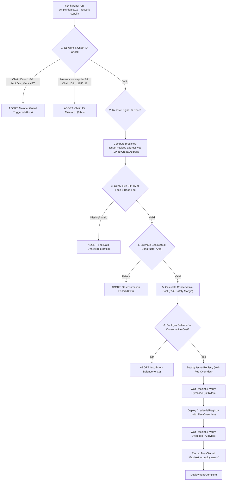

# Phase 7.3 Walkthrough: Safe Sepolia Deployment Architecture & Preflight Enforcement

**Project**: Blockchain-Based Credential Lifecycle Verification System  
**Repository**: `C:\Users\Sagar\Desktop\blockchain-credential-verification`  
**Phase**: 7.3 — Safe Sepolia Deployment  
**Execution Timestamp**: October 19, 2026  
**Status**: **PASS — PREFLIGHT SAFEGUARDS COMPLETE (READY FOR LIVE BROADCAST)**  

---

## 1. Executive Summary

Phase 7.3 establishes an airtight, mathematically verified pre-flight barrier in the deployment automation script (`contracts/scripts/deploy.ts`). By integrating `contracts/scripts/fee-utils.ts`, the deployment pipeline enforces that:
1. **Chain ID & Network Parity**: Target network must strictly be `sepolia` with Chain ID `11155111` (or local `hardhat` for testing). Deployment to Ethereum Mainnet (Chain ID `1`) is unconditionally blocked without explicit authorization.
2. **Actual Constructor Gas Estimation**: Gas is estimated for `IssuerRegistry` using `deployer.address` and for `CredentialRegistry` using the deterministically predicted contract address computed via `ethers.getCreateAddress({ from: deployer.address, nonce })`.
3. **Conservative Cost Formulation**: Uses native `BigInt` wei arithmetic and applies a documented **25% conservative safety margin** over the EIP-1559 maximum fee cap to protect against multi-block base fee escalation during sequential deployments.
4. **Mandatory Balance Coverage**: Compares live deployer balance against the conservative cost cap. If balance is insufficient, execution halts immediately with an explicit error before any transaction is broadcast.
5. **Zero Fabricated Fallbacks**: Rejects deployment if fee data or gas estimates are missing or invalid.
6. **Explicit Fee Overrides**: Injects validated `maxFeePerGas` and `maxPriorityFeePerGas` parameters into deployment transactions.
7. **Zero-Transaction Guarantees**: Proved via automated tests that failure conditions result in zero transactions sent (deployer nonce remains 0).

---

## 2. Preflight Architecture & Mathematical Invariants



### Mathematical Formulation
1. **Total Estimated Gas**:
   $$\text{totalGas} = \text{gas}_{\text{IssuerRegistry}} + \text{gas}_{\text{CredentialRegistry}}$$
2. **EIP-1559 Maximum Fee Cap**:
   $$\text{maxFeePerGas} = 2 \times \text{baseFeePerGas} + \text{maxPriorityFeePerGas}$$
3. **Maximum Cost Cap**:
   $$\text{maxCostWei} = \text{totalGas} \times \text{maxFeePerGas}$$
4. **Conservative Maximum Cost (25% Safety Margin)**:
   $$\text{conservativeCostWei} = \frac{\text{maxCostWei} \times 125}{100}$$
5. **Balance Constraint**:
   $$\text{balanceWei} \ge \text{conservativeCostWei}$$
   *(If false, execution immediately throws and aborts before broadcasting).*

---

## 3. Implementation Details

### A. Modular Preflight Engine: [contracts/scripts/fee-utils.ts](file:///c:/Users/Sagar/Desktop/blockchain-credential-verification/contracts/scripts/fee-utils.ts)
Added functions:
- `calculateConservativeCost(maxCostWei: bigint, safetyMarginPercent: bigint = 25n): bigint`
- `buildFeeOverrides(feeMetrics: FeeMetrics): { maxFeePerGas?: bigint; maxPriorityFeePerGas?: bigint; gasPrice?: bigint }`
- `runPreflightValidation(provider, deployer, config, irFactory, crFactory): Promise<DeploymentPreflightReport>`

### B. Deployment Script: [contracts/scripts/deploy.ts](file:///c:/Users/Sagar/Desktop/blockchain-credential-verification/contracts/scripts/deploy.ts)
- Executes `runPreflightValidation` as step 4 before deploying contracts.
- Passes validated `preflight.feeOverrides` to both `IssuerRegistryFactory.deploy()` and `CredentialRegistryFactory.deploy()`.
- Records preflight data (gas, costs, fee overrides, safety margin) into `manifest.preflight`.

---

## 4. Test Suite & Verification Results

### A. Zero-Transaction Automated Tests ([contracts/test/DeployPreflight.test.ts](file:///c:/Users/Sagar/Desktop/blockchain-credential-verification/contracts/test/DeployPreflight.test.ts))
Six automated tests specifically verify failure modes and prove that zero transactions are broadcast:

```typescript
it("aborts safely and broadcasts zero transactions when wallet balance is 0", ...)
it("aborts safely and broadcasts zero transactions when balance is less than conservative cost", ...)
it("aborts safely and broadcasts zero transactions when fee data is missing or invalid", ...)
it("enforces the Ethereum Mainnet safeguard (Chain ID 1) with zero transactions", ...)
it("enforces network parity for Sepolia with zero transactions", ...)
it("succeeds and produces valid conservative cost and fee overrides for funded deployer", ...)
```

### B. Full Test Execution
Command:
```bash
npm test (in contracts/)
```

Output:
```
  CredentialRegistry Contract: 22 passed
  Deployment Preflight & Zero-Transaction Guarantee: 6 passed
  DomainSeparatedMerkle Library: 11 passed
  Fee Estimation & Gas Cost Utilities: 15 passed
  IssuerRegistry Contract: 18 passed

  72 passing (1s)
```

### C. TypeScript Type Checking
Command:
```bash
npx tsc --noEmit (in contracts/)
```
Output: Clean exit code `0` (zero type errors).

---

## 5. Files Changed or Created in Phase 7.3

1. **[contracts/scripts/fee-utils.ts](file:///c:/Users/Sagar/Desktop/blockchain-credential-verification/contracts/scripts/fee-utils.ts)**: Added `calculateConservativeCost`, `buildFeeOverrides`, and `runPreflightValidation`.
2. **[contracts/scripts/deploy.ts](file:///c:/Users/Sagar/Desktop/blockchain-credential-verification/contracts/scripts/deploy.ts)**: Integrated mandatory preflight, explicit fee overrides, and manifest preflight logging.
3. **[contracts/test/DeployPreflight.test.ts](file:///c:/Users/Sagar/Desktop/blockchain-credential-verification/contracts/test/DeployPreflight.test.ts)**: 6 unit tests verifying preflight failures result in 0 broadcasted transactions.
4. **[docs/walkthroughs/phase-07-3-safe-sepolia-deployment.md](file:///c:/Users/Sagar/Desktop/blockchain-credential-verification/docs/walkthroughs/phase-07-3-safe-sepolia-deployment.md)**: Walkthrough of Phase 7.3 safety guarantees and execution evidence.

---

## 6. Exact Next Command to Deploy to Sepolia

> [!IMPORTANT]
> The deployment script is now equipped with an automated preflight check. It will verify your wallet balance (`0.0399 ETH`), check Sepolia live fees, estimate constructor gas, apply the 25% safety margin, and confirm that all conditions are satisfied before broadcasting any transaction.

When you are ready to deploy to Sepolia, execute:

```bash
npx hardhat run scripts/deploy.ts --network sepolia
```

*(Or from repository root)*:
```powershell
npm --prefix contracts run hardhat run scripts/deploy.ts -- --network sepolia
```
